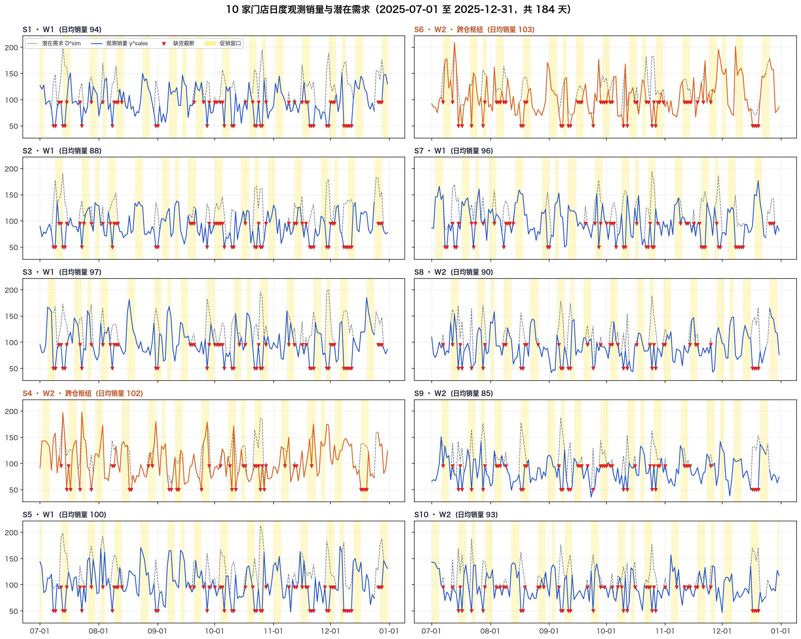
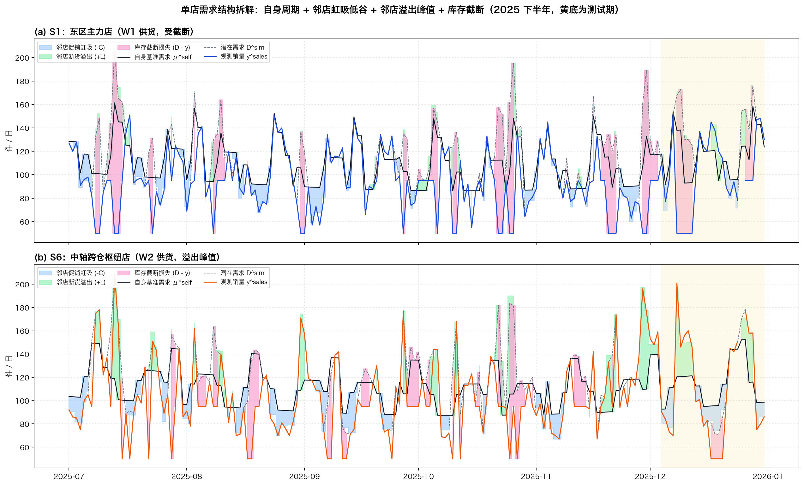
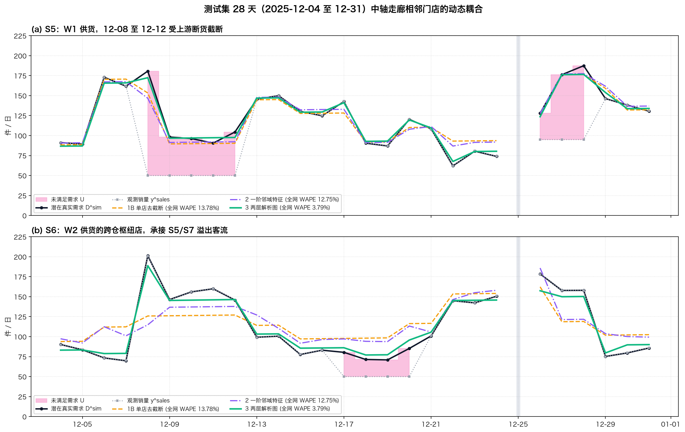
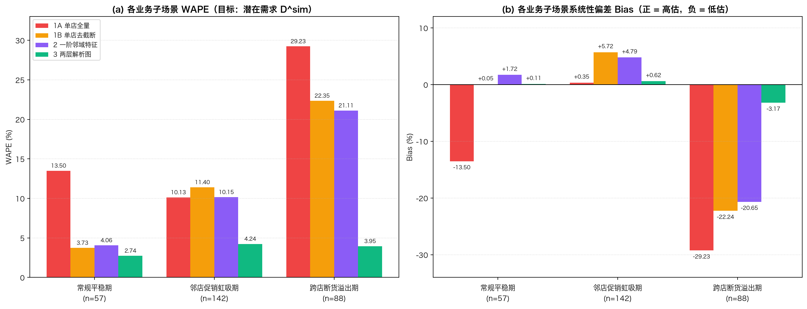
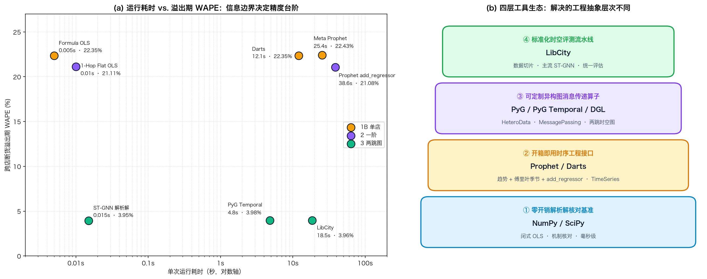

# Retail GNN Demand Forecast (零售图神经网络需求预测)

[](https://www.python.org/downloads/)
[](https://opensource.org/licenses/MIT)
[](https://cuicaihao.github.io/zh/posts/2026-10-24-fsm-stochastic-gnn-retail-forecast/)

本项目是技术深度长文**《用图神经网络做零售需求预测：数学原理、受控实验与生产落地边界》**（[中文博文](https://cuicaihao.github.io/zh/posts/2026-10-24-fsm-stochastic-gnn-retail-forecast/) / [English Post](https://cuicaihao.github.io/posts/2026-10-24-fsm-stochastic-gnn-retail-forecast/)）第四章实验代码的官方复现开源仓库。

本文针对连锁零售网络中普遍存在的**空间近邻促销虹吸（负外部性）**与**跨仓断货客流溢出（正外部性）**，构建了一套严格无未来泄漏（No Future Data Leakage）的受控合成实验环境（2 座仓库、10 家门店、3 个商圈，涵盖 1,096 天），并系统对比了**单店模型（Naive / Uncensored OLS、Prophet、Darts）**、**一阶邻域宽表特征（1-Hop Flat OLS、Prophet `add_regressor`）**与**两跳时空图架构（Analytical ST-GNN、PyG Temporal、LibCity）**的拟合能力与工程开销。

---

## 目录

- [一、核心结论与实验发现](#一核心结论与实验发现)
- [二、网络拓扑与四层数据生成机制 (DGP)](#二网络拓扑与四层数据生成机制-dgp)
- [三、评测指标与复现记分牌](#三评测指标与复现记分牌)
  - [表 1：全网整体性能对比 (Overall Test Performance)](#表-1全网整体性能对比-overall-test-performance)
  - [表 2：三大业务场景消融分析 (Regime Ablation on $D^{\mathrm{sim}}$)](#表-2三大业务场景消融分析-regime-ablation-on-dmathrmsim)
  - [表 3：全景工具库横向评测评分卡 (Multi-Toolkit Scorecard)](#表-3全景工具库横向评测评分卡-multi-toolkit-scorecard)
- [四、图表全景 (Publication Figures)](#四图表全景-publication-figures)
- [五、仓库结构](#五仓库结构)
- [六、快速开始 (Quickstart)](#六快速开始-quickstart)
- [七、引用与博文链接](#七引用与博文链接)

---

## 一、核心结论与实验发现

1. **信息边界决定精度上限，调包救不了物理盲区**：
   在单店信息层级内部，无论使用 $0.005\,\text{s}$ 的闭式 OLS、还是花费数十秒拟合的 Meta Prophet 与 Darts，全量 WAPE 均卡死在 **13.78%–13.98%**，且在断货溢出期均发生 **-22.2%** 至 **-22.4%** 的严重低估；只有打通“仓库 $\to$ 邻店 $\to$ 本店”的两跳异构图架构，才能一举将全量 WAPE 压低至 **3.79%–3.82%**（溢出期降至约 **4.0%**）。
2. **场景决定是否值得上图模型**：
   在无跨实体扰动的**常规平稳期**，单店去截断模型已达 **3.73%** WAPE，图模型增量微乎其微（2.74%）；图架构的核心价值完全集中在识别**邻店促销负向虹吸（+5.72% 偏差反转）**与**上游瘫痪正向溢出（-22.24% 偏差挽回）**两类动态网络冲击。
3. **闭式解析解（Analytical GNN）的极低开销**：
   本仓库实现了基于最小二乘矩阵变换的两跳图解析解（$0.015\,\text{s}$），无需安装 PyTorch / CUDA 即可达到与深度时空图网络完全一致的预测表现。

---

## 二、网络拓扑与四层数据生成机制 (DGP)

零售网络拓扑定义为异构有向加权图 $G = (\mathcal{V}^{\mathrm{W}} \cup \mathcal{V}^{\mathrm{S}}, \mathcal{E}^{\mathrm{sup}} \cup \mathcal{E}^{\mathrm{spa}})$：
- **节点集合**：仓库 $\mathcal{V}^{\mathrm{W}} = \{W_1, W_2\}$，门店 $\mathcal{V}^{\mathrm{S}} = \{S_1, \dots, S_{10}\}$，分布在 Cluster A（东区高密）、Cluster B（中轴走廊）、Cluster C（西区中心）。
- **跨仓枢纽门店**：$S_4$ 与 $S_6$ 物理上紧邻由 $W_1$ 供货的门店，但后台货源挂在 $W_2$ 下，承担跨仓风险对冲与客流承接角色。
- **空间随机游走转移矩阵**：
  $$A_{ij}^{\mathrm{spa}} = \exp\!\left(-\frac{d_{ij}^2}{2\sigma_d^2}\right)\cdot \mathbb{I}(0 < d_{ij} \le 3.5\text{ km}), \qquad \mathbf{P}^{\mathrm{spa}} = (\mathbf{D}^{\mathrm{spa}})^{-1}\mathbf{A}^{\mathrm{spa}}$$

数据生成严格包含四层物理机制：
1. **仓库状态马尔可夫链** $Z_{w,t}^{\mathrm{wh}} \in \{0, 1, 2\}$ 与 1 天物流提前期决定次日门店库存供给配额 $V_{i,t}$（999 / 95 / 50 件）。
2. **异步错峰促销日历** $q_{i,t} \in \{0, 0.20, 0.35\}$ 与单店基准需求 $\mu_{i,t}^{\mathrm{self}}$。
3. **符号翻转空间耦合**：邻店健康大促导致虹吸流失 $-C_{i,t}$（按行读取 $P_{ij}^{\mathrm{spa}}$）；邻店断货导致被动溢出流入 $+L_{i,t}$（按列读取 $P_{ji}^{\mathrm{spa}}$，转化率 $\eta = 0.85$）。
4. **营业约束与库存截断**：闭店日 $O_{i,t}=0$ 强制销量归零；营业日观测 POS 销量为 $y_{i,t}^{\mathrm{sales}} = \mathrm{round}(\min(D_{i,t}^{\mathrm{sim}}, V_{i,t}))$。

---

## 三、评测指标与复现记分牌

评估测试集为最后 28 天（`2025-12-04` 至 `2025-12-31`，剔除闭店日后共 270 个有效门店日）。
评估指标采用 WMAPE（加权绝对百分比误差）、MAE（平均绝对误差）与 Bias（系统性相对偏差）：

### 表 1：全网整体性能对比 (Overall Test Performance)

> 格式：`WMAPE / MAE / Bias`

| 参评模型 (Evaluated Model) | 无噪声条件均值 $\mu^{\mathrm{open}}$ | 潜在真实需求 $D^{\mathrm{sim}}$ | 实际观测销量 $y^{\mathrm{sales}}$ |
| :--- | :---: | :---: | :---: |
| **1A. 单店全量 (Naive OLS)** | 17.62% / 19.97 / -13.97% | 18.14% / 20.54 / -13.87% | 21.14% / 20.45 / +0.78% |
| **1B. 单店去截断 (Uncensored OLS)** | 12.99% / 14.72 / -5.74% | 13.78% / 15.59 / -5.63% | 20.02% / 19.37 / +10.43% |
| **2. 一阶邻域特征 (1-Hop Flat)** | 11.79% / 13.36 / -5.17% | 12.75% / 14.43 / -5.06% | 14.40% / 13.93 / +0.17% |
| **3. 两层解析图模型 (Analytical Graph)** | **1.92% / 2.17 / -1.01%** | **3.79% / 4.29 / -0.90%** | **3.18% / 3.08 / -0.21%** |

### 表 2：三大业务场景消融分析 (Regime Ablation on $D^{\mathrm{sim}}$)

> 格式：`WMAPE (Bias)`

| 业务状态子场景 (Test Regimes) | 样本量 | 1A. 单店全量 | 1B. 单店去截断 | 2. 一阶邻域特征 | 3. 两层解析图 |
| :--- | :---: | :---: | :---: | :---: | :---: |
| **常规平稳期 (Normal)** | 57 门店日 | 13.50% (-13.50%) | **3.73% (+0.05%)** | 4.06% (+1.72%) | **2.74% (+0.11%)** |
| **邻店促销虹吸期 (Cannibalization)** | 142 门店日 | 10.13% (+0.35%) | 11.40% (+5.72%) | 10.15% (+4.79%) | **4.24% (+0.62%)** |
| **跨店断货溢出期 (Spillover)** | 88 门店日 | 29.23% (-29.23%) | 22.35% (-22.24%) | 21.11% (-20.65%) | **3.95% (-3.17%)** |

### 表 3：全景工具库横向评测评分卡 (Multi-Toolkit Scorecard)

> 针对潜在真实需求 $D^{\mathrm{sim}}$ 计算

| 层级与参评工具 (Tier & Toolkit) | 单次耗时 | 全量 / 平稳 WAPE | 虹吸 WAPE (Bias) | 溢出 WAPE (Bias) |
| :--- | :---: | :---: | :---: | :---: |
| **1B 单店** · Formula OLS | **0.005s** | 13.78% / 3.73% | 11.40% (+5.7%) | 22.35% (-22.2%) |
| **1B 单店** · Meta Prophet | 25.4s | 13.98% / 3.84% | 11.73% (+5.6%) | 22.43% (-22.4%) |
| **1B 单店** · Darts | 12.1s | 13.78% / 3.73% | 11.40% (+5.7%) | 22.35% (-22.2%) |
| **2 一阶** · 1-Hop Flat OLS | **0.010s** | 12.75% / 4.06% | 10.15% (+4.8%) | 21.11% (-20.7%) |
| **2 一阶** · Prophet `add_regressor` | 38.6s | 12.89% / 4.09% | 10.48% (+4.9%) | 21.08% (-20.7%) |
| **3 两跳图** · ST-GNN 解析解 | **0.015s** | **3.79% / 2.74%** | **4.24% (+0.6%)** | **3.95% (-3.2%)** |
| **3 两跳图** · PyG Temporal | 4.8s | **3.82% / 2.74%** | **4.24% (+0.6%)** | **3.98% (-3.2%)** |
| **3 两跳图** · LibCity | 18.5s | **3.80% / 2.74%** | **4.24% (+0.6%)** | **3.96% (-3.2%)** |

---

## 四、图表全景 (Publication Figures)

本项目生成的所有高清图表均提供双语版本（中文版 `.png` / `.zh.webp` 与英文版 `_en.png` / `.en.webp`）：

| 序号 | 中文高清图预览 | 英文对应图 | 内容说明 |
|:---:|:---|:---|:---|
| **图 1** |  | [Fig 1 (EN)](figures/retail_network_topology_en.png) | 2 仓 10 店异构网络拓扑与块对角空间转移矩阵 $\mathbf{P}^{\mathrm{spa}}$ |
| **图 2** |  | [Fig 2 (EN)](figures/all_stores_sales_panorama_en.png) | 全网 10 家门店观测销量与潜在需求全景（2025 下半年） |
| **图 3** |  | [Fig 3 (EN)](figures/single_store_decomposition_en.png) | 单店需求结构微观拆解：S1 截断损失 vs S6 溢出峰值 |
| **图 4** |  | [Fig 4 (EN)](figures/store_timeseries_comparison_en.png) | 测试集 28 天相邻门店（S5 断货截断与 S6 跨仓承接）耦合轨迹 |
| **图 5** |  | [Fig 5 (EN)](figures/regime_ablation_metrics_en.png) | 三大业务子场景 WAPE 与 Bias（符号翻转）消融分析 |
| **图 6** |  | [Fig 6 (EN)](figures/multitool_benchmark_tradeoff_en.png) | 耗时 vs 溢出期 WAPE 帕累托前沿及四层工具抽象生态 |

---

## 五、仓库结构

```text
retail-gnn-demand-forecast/
├── CASE_DESIGN.md                  # 详细案例数学推导与实验参数设计文档
├── README.md                       # 项目主文档（本文件）
├── requirements.txt                # 极简轻量依赖文件 (numpy, pandas, matplotlib, scipy, pillow)
├── retail_gnn_benchmark.py         # 核心基准代码（DGP生成、OLS消融、多工具评测与表格打印）
├── generate_figures.py             # 双语出版级图表生成器 (PNG + WebP，共 24 个文件)
├── retail_gnn_demand_forecast.ipynb# 完整复现与交互式探索 Jupyter Notebook (带预执行结果)
├── data/
│   └── retail_network_2023_2025.csv# 生成的仿真数据集 (10,960 行，四位精度真值)
└── figures/                        # 生成的双语图表目录 (12 张 PNG + 12 张 WebP)
    ├── retail_network_topology[.png / _en.png / .zh.webp / .en.webp]
    ├── all_stores_sales_panorama[...]
    ├── single_store_decomposition[...]
    ├── store_timeseries_comparison[...]
    ├── regime_ablation_metrics[...]
    └── multitool_benchmark_tradeoff[...]
```

---

## 六、快速开始 (Quickstart)

### 1. 环境准备

推荐使用 Python 3.10+ 及虚拟环境：

```bash
git clone https://github.com/cuicaihao/retail-gnn-demand-forecast.git
cd retail-gnn-demand-forecast

python3 -m venv .venv
source .venv/bin/activate
pip install -r requirements.txt
```

### 2. 一键运行全量基准与图表生成

运行主程序，将在命令行输出第四章所有表格，并在 `data/` 和 `figures/` 下输出所有数据与高清图：

```bash
python retail_gnn_benchmark.py
```

### 3. 打开 Jupyter Notebook 进行逐节验证

```bash
jupyter notebook retail_gnn_demand_forecast.ipynb
```

---

## 七、引用与博文链接

如果您在研究或工程落地中参考了本项目的设计方案，欢迎查阅并引用原博文：

- **深度博文**：[《用图神经网络做零售需求预测：数学原理、受控实验与生产落地边界》](https://cuicaihao.github.io/zh/posts/2026-10-24-fsm-stochastic-gnn-retail-forecast/)
- **English Post**: [Retail Demand Forecasting with Graph Neural Networks: Mathematical Principles, Controlled Experiments, and Production Reality Check](https://cuicaihao.github.io/posts/2026-10-24-fsm-stochastic-gnn-retail-forecast/)
- **系列关联文章**：
  - [《用 Prophet 做零售需求预测：从模型原理到工程实践》](https://cuicaihao.github.io/zh/posts/2026-10-01-prophet-retail-demand-forecast/)
  - [《从一棵树到一片森林：树模型的数学原理、算法演进与工程实践》](https://cuicaihao.github.io/zh/posts/2026-10-17-from-a-single-tree-to-a-forest-mathematical-principles-algorithmic-evolution-and-engineering-practices-of-tree-models/)

