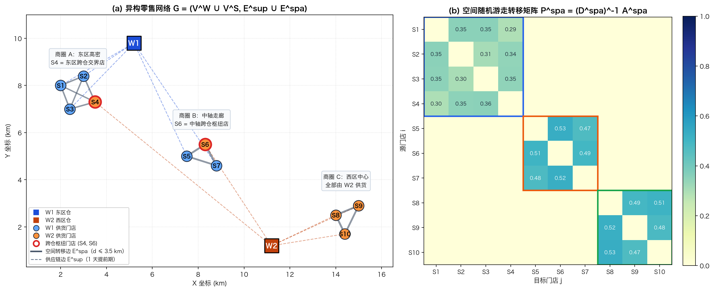
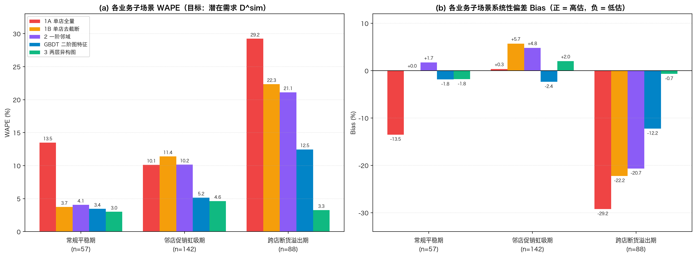
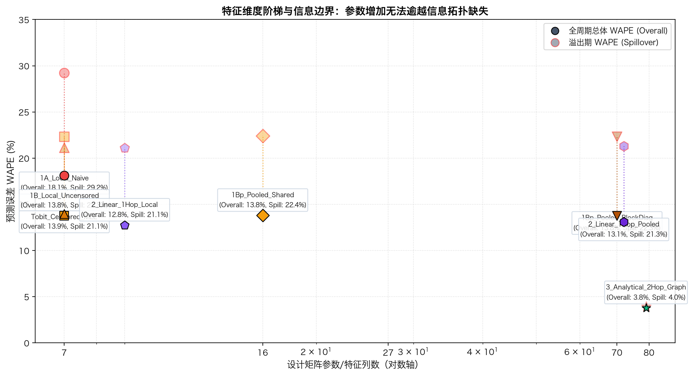
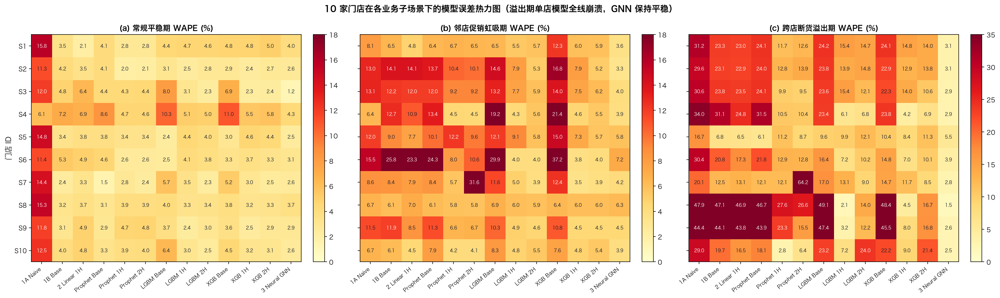
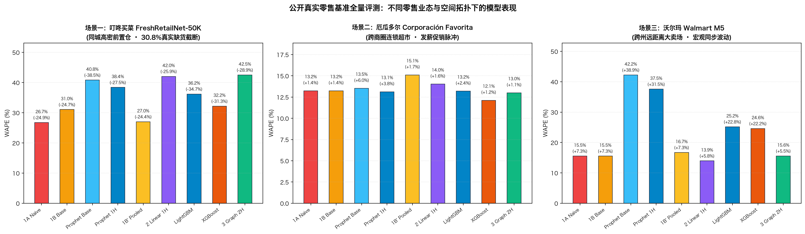
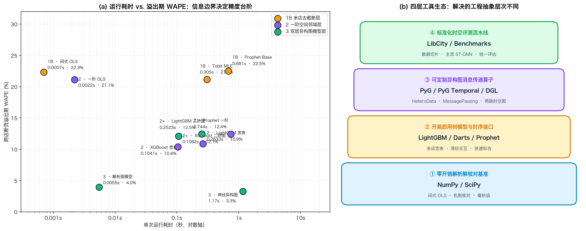

# 零售门店网络需求预测技术与实验全景报告 (`experimental-report.md`)

> **阅读指南**：本报告将枯燥的算法评测还原为真实的零售门店经营故事，结合严谨的数学物理机制与工程实测。前两节介绍「2 座仓库 + 10 家门店 + 3 个商圈」的受控网络拓扑与四层数据生成过程（DGP）；随后在**实验一、实验二、实验三**以及**实验四（三大真实公开工业级基准）**中，严格按照 **「① 实验目的 → ② 数据结构是否与目的一致 → ③ 参评模型与成绩单 → ④ 业务案例讲透结果」** 的逻辑展开。

---

## 零、受控实验设计动机与零售网络物理机制

### 1. 设计动机：什么样的受控实验能检验图结构的信息价值？

在单店预测场景中，单店时间序列模型（如 Prophet）利用门店自身的历史销量、长期趋势、周度/年度季节性、节假日以及促销计划，在对无噪声营业日真实需求均值 $\mu_t^{\mathrm{open}}$ 的还原上就能达到不足 **0.5% WAPE** 的极高精度。

如果在合成多门店数据时，仅仅让 10 家门店共享相同的天气、节假日或同频促销，**单店模型通过自身日历特征就能充分吸收这些共性变化，图神经网络（GNN）并不会产生实质性增量**。即便引入跨店关联，若仅表现为固定符号的静态线性相关，传统的**一阶邻域特征工程（1-Hop Flat）**（如宽表中拼接邻店平均促销强度或滞后销量）也足以胜任。

因此，为了构建一个既符合真实零售履约与商圈竞争逻辑、又能剥离模型复杂度干扰以严格检验图结构信息边界的受控基准，数据生成过程（DGP）必须具备三个结构性机制：

1. **两跳异构传导路径（2-Hop Heterogeneous Path）**：

   $$\text{邻店上游仓库 } W_{w(j)} \xrightarrow[\text{1天日配物流提前期}]{\mathcal{E}^{\mathrm{sup}}} \text{邻店库存上限 } V_{j,t} \xrightarrow[\text{空间客流转移}]{\mathcal{E}^{\mathrm{spa}}} \text{当前门店需求 } \mu_{i,t}^{\mathrm{open}}$$

2. **符号翻转的双向非线性交互（Sign-Flipping Regime Interaction）**：
   邻店 $j$ 的大促 $q_{j,t}$ 对当前门店 $i$ 的影响正负号取决于邻店背后仓库是否断货：
   - **当邻店仓库供货正常($Z_{w(j),t-1}^{\mathrm{wh}}=0$)**：邻店大促吸走本店客流，产生**负向促销虹吸(Cannibalization, $\frac{\partial \mu_{i,t}}{\partial q_{j,t}} < 0$)**；
   - **当邻店仓库断货受限($Z_{w(j),t-1}^{\mathrm{wh}} \in \{1, 2\}$)**：邻店大促迅速卖空触发库存截断，未满足顾客涌入本店，产生**正向断货溢出(Spillover, $\frac{\partial \mu_{i,t}}{\partial q_{j,t}} > 0$)**。
3. **跨仓交界枢纽的参数共享与归纳迁移**：
   在同一商圈部署由不同仓库供货的交界店($S_4, S_6$)。当东区仓 $W_1$ 断货时， $W_1$ 供货的门店销量被死死卡在 50 件上限，无法直接观测真实需求；但同商圈内由西区仓 $W_2$ 供货的交界店货源充足，能完整记录溢出客流峰值。图模型利用消息传递算子，从未截断样本中学出溢出算子并推广至全网。

---

### 2. 异构零售网络拓扑规范


> 📊 **图 1 说明**：
>
> - **(a) 左图（物理网络拓扑）**：展示「2 座供货仓库($W_1$ 橙红、 $W_2$ 蓝青)+ 10 家门店 + 3 大地理商圈」的物理空间分布。虚线代表上游供货链路 $\mathcal{E}^{\mathrm{sup}}$ ，实线代表门店间基于步行距离衰减的客流转移边 $\mathcal{E}^{\mathrm{spa}}$ ；**红色加粗边框突出标出了两家关键的跨仓枢纽店**——东区商圈内由 $W_2$ 供货的 $S_4$ 以及中轴走廊中间夹心的 $S_6$ 。
> - **(b) 右图(空间转移矩阵 $\mathbf{P}^{\mathrm{spa}}$ 热力图)**：对角线置 0（消除自身转移），以 Blues 蓝色深浅呈现同一商圈内邻近门店间的转移概率 $P_{ij}^{\mathrm{spa}}$ ；商圈外部转移概率严格归零（呈现白色空白），体现出清晰的地理局部性。
> - *对应数据：[`plot_fig1_topology_nodes.csv`](results/plot_data/plot_fig1_topology_nodes.csv) 与 [`plot_fig1_spatial_matrix.csv`](results/plot_data/plot_fig1_spatial_matrix.csv)*

网络拓扑定义为异构有向加权图 $G = (\mathcal{V}^{\mathrm{W}} \cup \mathcal{V}^{\mathrm{S}}, \; \mathcal{E}^{\mathrm{sup}} \cup \mathcal{E}^{\mathrm{spa}})$ ：

- **仓库集合**： $\mathcal{V}^{\mathrm{W}} = \{W_1\text{ (东区仓)}, W_2\text{ (西区仓)}\}$
- **门店集合**： $\mathcal{V}^{\mathrm{S}} = \{S_1, \dots, S_{10}\}$ ，划分为三大地理商圈：

| 商圈名称 | 包含门店 | 供货仓库 | 坐标 $(x, y)$ (km) | 门店在网络中的拓扑角色与日常处境 |
| :--- | :--- | :--- | :--- | :--- |
| **东区高密商圈**<br>*(Cluster A)* | **$S_1, S_2, S_3$**<br>**$S_4$ （跨仓交界店）** | $S_1\text{--}S_3$ 靠 **$W_1$**<br>**$S_4$ 靠 $W_2$** | $S_1(2.0, 8.0)$ <br> $S_2(3.0, 8.4)$ <br> $S_3(2.4, 7.0)$ <br> $S_4(3.5, 7.3)$ | 四家店扎堆在东区核心街区（步行几分钟互通）。前三家店同吃东区仓 $W_1$ 大锅饭；唯独 **$S_4$ 是由西区仓 $W_2$ 供货的交界店**。当 $W_1$ 断货时， $S_1\text{--}S_3$ 限购，顾客全部涌向货源充足的 $S_4$ 。 |
| **中轴走廊商圈**<br>*(Cluster B)* | **$S_5, S_7$ （东西侧翼）**<br>**$S_6$ （跨仓枢纽店）** | $S_5, S_7$ 靠 **$W_1$**<br>**$S_6$ 靠 $W_2$** | $S_5(7.5, 5.0)$ <br> $S_6(8.3, 5.5)$ <br> $S_7(8.8, 4.6)$ | 三家店沿城市主干道排布，**$S_6$ 夹在 $S_5$ 与 $S_7$ 正中间**。平时 $S_5, S_7$ 轮流大促吸走 $S_6$ 客流；一旦 $W_1$ 断货， $S_5$ 与 $S_7$ 的溢出客流左右夹击灌入中间由 $W_2$ 供货的 $S_6$ 。 |
| **西区区域中心**<br>*(Cluster C)* | **$S_8, S_9, S_{10}$** | 全部靠 **$W_2$** | $S_8(14.0, 2.5)$ <br> $S_9(15.0, 2.9)$ <br> $S_{10}(14.4, 1.7)$ | 独立西区商圈，远离东区中轴（无客流往来），且**共用西区仓 $W_2$**。同甘共苦，商圈内几乎不存在跨仓不对称大转移，是天然的同质对照组。 |

**空间随机游走转移矩阵**：

$$A_{ij}^{\mathrm{spa}} = \exp\!\left(-\frac{d_{ij}^2}{2\sigma_d^2}\right)\cdot \mathbb{I}(0 < d_{ij} \le 3.5\text{ km}), \qquad \mathbf{P}^{\mathrm{spa}} = (\mathbf{D}^{\mathrm{spa}})^{-1}\mathbf{A}^{\mathrm{spa}}$$

---

### 3. 四层耦合数据生成机制 (DGP)


> 📊 **图 2 说明（全网 10 店销售全景）**：
>
> - 展现 2025-07-01 至 12-31（共 184 天）全网 10 家门店的时序面板（5 行 2 列）。
> - **灰色虚线**为无约束的潜在真实需求真值 $D_{i,t}^{\mathrm{sim}}$ ；**彩色实线**为实际入账销量 $y_{i,t}^{\mathrm{sales}}$ (交界枢纽店 $S_4, S_6$ 标题与实线为暖橙色，其余普通店为深蓝色)。
> - **黄色垂直半透明阴影带**标定各店自身的促销窗口(大促 $q=0.35$ 与中促 $q=0.20$)；**红色倒三角**精准标出发生库存耗尽截断($D > V$)的缺货点，直观可见 $W_1$ 供货门店在 12 月多次被截断按平在 50 件上限。
> - *对应数据：[`plot_fig2_panorama_184d.csv`](results/plot_data/plot_fig2_panorama_184d.csv)*


> 📊 **图 3 说明（单店需求物理层分解）**：
>
> - 对比东区主力店 $S_1$ (上图，由 $W_1$ 供货受截断)与中轴跨仓枢纽店 $S_6$ (下图，由 $W_2$ 供货承接溢出客流)的四层物理量动态演化。
> - **黑色实线**为单店自身独立基准需求 $\mu_{i,t}^{\mathrm{self}}$ ；**蓝色填充区**代表受邻店促销分流导致的客流虹吸损失($-C$)；**浅绿色填充区**代表邻店断货涌入本店的正向溢出增量($+L$)；**粉红色填充区**代表货架缺货被截断造成的实体失销损失($D^{\mathrm{sim}} - y^{\mathrm{sales}}$)。
> - 右侧浅黄色半透明阴影区域标出最后 28 天（12-04 至 12-31）的统一评测测试集，可见 $S_6$ 在测试期承接了多波高达数十件的断货溢出客流（浅绿峰值）。
> - *对应数据：[`plot_fig3_decomposition_s1_s6.csv`](results/plot_data/plot_fig3_decomposition_s1_s6.csv)*

- **时间轴**：`2023-01-01` 至 `2025-12-31`($T = 1,096$ 天)。前 1,068 天训练，后 28 天（`2025-12-04` 至 `12-31`）测试。
- **Layer 1（仓库马尔可夫链）**： $Z_{w,t}^{\mathrm{wh}} \in \{0\text{ (正常)}, 1\text{ (拥堵)}, 2\text{ (断货)}\}$ ，时齐转移矩阵驱动。次日门店库存上限 $V_{i,t} \in \{999, 95, 50\}$ 。测试集包含三次典型冲击：
  - `12-08` 至 `12-12`： $W_1$ 发生 5 天严重断货($V = 50$)；
  - `12-17` 至 `12-20`： $W_2$ 发生 4 天严重断货($V = 50$)；
  - `12-25` 至 `12-28`： $W_1$ 发生 4 天分拣拥堵($V = 95$)。
- **Layer 2（错峰促销与单店基准需求）**：各店配置不同相位偏移 $\phi_i$ ，交错进行 8 折($q=0.20$)与 65 折($q=0.35$)大促。
- **Layer 3（双向空间耦合）**：
  - 虹吸流失： $C_{i,t} = \sum_j P_{ij}^{\mathrm{spa}} \cdot 125 \cdot \max(0, q_{j,t} - q_{i,t}) \cdot \mathbb{I}(V_{j,t} > 120)$
  - 溢出流入： $L_{i,t} = \sum_j 0.85 \cdot P_{ji}^{\mathrm{spa}} \cdot \max(0, \mu_{j,t}^{\mathrm{self}} - C_{j,t} - V_{j,t})$
- **Layer 4（营业约束与库存截断）**：

  $$\mu_{i,t}^{\mathrm{open}} = \max(10, \mu_{i,t}^{\mathrm{self}} - C_{i,t} + L_{i,t}), \qquad D_{i,t}^{\mathrm{sim}} = \max(0, \mu_{i,t}^{\mathrm{open}} + \epsilon_{i,t}), \quad \epsilon \sim \mathcal{N}(0, 4.5^2)$$

  $$y_{i,t}^{\mathrm{sales}} = O_t \cdot \mathrm{round}(\min(D_{i,t}^{\mathrm{sim}}, V_{i,t}))$$

---

### 4. 统一评测协议：输入特征、输出定义与误差计算公式 (Evaluation Protocol)

为了让所有读者彻底看清每个模型的输入信息边界、输出物理含义以及评测指标的数学来由，本套件遵循严格的因果与对账规范：

#### 1) 模型的输入到底是什么？ (Inputs)

所有模型在预测第 $t$ 天门店 $i$ 的需求时，**严格遵守时间因果律（No Future Leakage）**，输入特征分为三大层次：

- **第一层：外生确定的日历与计划特征（已知未来）**：
  - 时间趋势 $\frac{t}{1000}$ 、周末标识 $W_t \in \{0, 1\}$ 、年度正余弦傅里叶周期 $(\sin_t, \cos_t)$ 、法定节假日 $H_t \in \{0, 1\}$ ；
  - 零售商提前制定的本期促销排期计划 $q_{i,t} \in [0, 1]$ 与营业开关 $O_t \in \{0, 1\}$ 。
- **第二层：严格因果的滞后自回归特征（历史观测）**：
  - 前一日自身实际观测销量 $y_{i,t-1}^{\mathrm{sales}}$ 以及过去 7 天滚动均值 $\bar{y}_{i,t-7..t-1}^{\mathrm{sales}}$ ；
  - 历史缺货记录 $\mathbb{I}_{i,t}^{\mathrm{stockout}}$ (用于 $L1$ 等去截断模型在训练集剔除被库存压制的不真实样本)。
- **第三层：网络拓扑与上游供应链状态（空间与异构视野）**：
  - 静态空间邻接与转移矩阵 $\mathbf{P}^{\mathrm{spa}} \in \mathbb{R}^{10 \times 10}$ （步行距离核函数生成，保持不变）；
  - 供货仓库昨日的离散运行状态 $Z_{w(i),t-1}^{\mathrm{wh}} \in \{0\text{ (正常)}, 1\text{ (拥堵)}, 2\text{ (断货)}\}$ （仅两跳模型与宽表 GBDT 允许读取）。

#### 2) 模型的输出到底是什么？ (Outputs)

- **核心预测目标：无约束潜在真实需求（Unconstrained Latent Demand）**：
  模型输出的数值 $\hat{y}_{i,t}$ (记为 $\hat{D}_{i,t}$)物理含义是：**“如果今天货架充足、仓库不断货，门店 $i$ 本身加上所有涌入的客流，真实能卖出多少件？”**
  - **为何预测潜在需求而非截断销量？** 零售供应链的订货、补货（Replenishment）与安全库存设定必须以真实潜在客流为准。若只预测被 50 件上限按住的销量，系统将陷入“断货 → 销量低 → 少订货 → 更严重断货”的恶性死循环（Censoring Spiral）。
- **衍生入账销量预测（Constrained Sales Forecast）**：
  在需要核算财务实收营收的场景下，受限销量预测直接由潜在需求截断得到： $\hat{y}_{i,t}^{\mathrm{sales}} = O_t \cdot \min(\hat{D}_{i,t}, V_{i,t})$ 。

#### 3) 误差是如何计算的？ (Error Metrics & Evaluation Targets)

在受控沙盒实验（实验一至三）中，由于真实世界底层的无约束潜在需求 $D_{i,t}^{\mathrm{sim}}$ 完全可知，所有模型在测试集（最后 28 天）上的预测输出 $\hat{y}_{i,t}$ 均**直接与潜需求真值 $D_{i,t}^{\mathrm{sim}}$ 逐日逐店严格对账**；而在真实公开数据集（实验四）中，由于真值无约束需求不可见，对账目标退化为真实观测销量 $y_{i,t}^{\mathrm{sales}}$ 。

评估指标在指定业务切片样本集 $\mathcal{S}$ 上计算：

1. **加权绝对百分比误差（WAPE, %）—— 核心综合精度指标**：

   $$\mathrm{WAPE} = \frac{\sum_{(i,t) \in \mathcal{S}} |\hat{y}_{i,t} - D_{i,t}^{\mathrm{sim}}|}{\sum_{(i,t) \in \mathcal{S}} D_{i,t}^{\mathrm{sim}}} \times 100\%$$

   - *特点*：相比传统 MAPE 在低销量日分母接近 0 产生数十倍失真爆发的问题，WAPE 以全局总需求为分母加权，完全消除了除零奇点，是工业界供应链对账的金标准。
2. **平均绝对误差（MAE, 件/天）—— 实体物理量误差**：

   $$\mathrm{MAE} = \frac{1}{|\mathcal{S}|} \sum_{(i,t) \in \mathcal{S}} |\hat{y}_{i,t} - D_{i,t}^{\mathrm{sim}}|$$

   - *特点*：直接以“件/天”为量纲，直观体现单店每天平均备货量偏差了多少件实体商品。
3. **系统性偏差率（Bias, %）—— 备货方向诊断指标**：

   $$\mathrm{Bias} = \frac{\sum_{(i,t) \in \mathcal{S}} (\hat{y}_{i,t} - D_{i,t}^{\mathrm{sim}})}{\sum_{(i,t) \in \mathcal{S}} D_{i,t}^{\mathrm{sim}}} \times 100\%$$

   - *特点*：**正偏($+$, Over-forecast)**意味着模型过度估计导致压仓滞销；**负偏($-$, Under-forecast)**意味着模型系统性少报漏报，导致严重缺货失销。
4. **四大业务评测切片集合 $\mathcal{S}$**：
   - **总体测试集(Overall, $n=270$ 样本点)**：测试期所有开门营业的门店日，即 $t \ge 1,068$ 且 $O_t = 1$ (27 个营业日 $\times$ 10 家店，排除 12-25 圣诞闭店)；
   - **常规平稳期(Normal, $n=57$ 样本点)**：自身与周边均无断货大促冲击的平稳营业日($C_{i,t} \le 5, L_{i,t} \le 5, V_{i,t} \ge 100$)；
   - **邻店促销虹吸期(Cannibalization, $n=142$ 样本点)**：邻居大促从本店分流客流的时期($C_{i,t} > 5.0$)；
   - **跨店断货溢出期(Spillover, $n=88$ 样本点)**：邻居仓库断货受限、客流跨店涌入本店的爆单时期($L_{i,t} > 5.0$)。

---

## 一、实验一：只用线性公式，逐步扩展特征会发生什么？

### 1. 实验目的与控制变量

严格控制所有模型一律采用**闭式最小二乘回归（OLS）**（以及用于处理截断的标杆 Tobit MLE），排除算法非线性表征能力的干扰，每次只改变一个变量：

1. 不剔除缺货假账会偏多少？($L0$ vs. $L1$)
2. 不加邻居信息，仅合 10 店数据合账训练能否救回溢出漏报？($L1$ vs. $L2a/L2b$)
3. 仅加邻店表面促销为何左右为难？($L3/L3p$)
4. 引入“邻居打折 $\times$ 仓库断货”显式两跳组合后误差能降到多少？($L4$)

### 2. 模型数学表达式与规模推导 (L0 至 L4)

所有消融模型均统一在单店需求预测方程 $\hat{y}_{i,t} = O_t \cdot \max(0, \mathbf{x}_{i,t}^\top \boldsymbol{\beta})$ 框架下对比，核心区别在于特征向量 $\mathbf{x}_{i,t}$ 的信息覆盖、训练样本筛选规则及参数分配方式。

#### 1) 符号体系与基础单店特征定义（7 维局部基准）

为确保全篇符号严格统一，符号与物理含义规范如下：

| 符号 | 物理含义与取值空间 | 在 DGP 与模型中的角色说明 |
| :--- | :--- | :--- |
| $t$ | 时间索引， $t \in \{0, 1, \dots, T-1\}$ (共 $T=1,096$ 天) | 从基准日 `2023-01-01` 算起， $t < 1,068$ 为训练期，其余 28 天为测试期。 |
| $i, j$ | 门店索引， $i, j \in \{1, 2, \dots, 10\}$ | 全网 10 家零售门店($S_1 \dots S_{10}$)。 |
| $w(i)$ | 供货仓库映射， $w(i) \in \{W_1, W_2\}$ | $S_1, S_2, S_3, S_5, S_7$ 由 $W_1$ 供货； $S_4, S_6, S_8, S_9, S_{10}$ 由 $W_2$ 供货。 |
| $Z_{w,t}^{\mathrm{wh}}$ | 仓库马尔可夫状态， $Z_{w,t}^{\mathrm{wh}} \in \{0, 1, 2\}$ | ${0}=\text{正常}$ （供货上限 999 件）， ${1}=\text{拥堵}$ （上限 95 件）， ${2}=\text{断货}$ （上限 50 件）。 |
| $V_{i,t}$ | 门店进货库存物理上限， $V_{i,t} \in \{999, 95, 50\}$ | 由前一日所属仓库状态决定： $V_{i,t} = \mathrm{Cap}(Z_{w(i),t-1}^{\mathrm{wh}})$ 。 |
| $q_{i,t}$ | 本店促销折扣深度， $q_{i,t} \in [0, 1]$ | 日常平稳期为 ${0.0}$ ，中促为 ${0.20}$ （8 折），大促为 ${0.35}$ （65 折）。 |
| $O_t$ | 营业日开关， $O_t \in \{0, 1\}$ | 仅圣诞节当天（12-25）闭店 $O_t=0$ ；正常营业日 $O_t=1$ 。 |
| $\mathbb{I}_{i,t}^{\mathrm{stockout}}$ | 缺货截断指示变量， $\mathbb{I}_{i,t}^{\mathrm{stockout}} \in \{0, 1\}$ | 当潜在需求超出进货上限且开业时为 1： $\mathbb{I}(D_{i,t}^{\mathrm{sim}} > V_{i,t} \text{ 且 } O_t=1)$ 。 |
| $P_{ij}^{\mathrm{spa}}$ | 空间随机游走转移概率， $P_{ij}^{\mathrm{spa}} \ge 0, \sum_j P_{ij}^{\mathrm{spa}}=1$ | 顾客因就近原则由源门店 $i$ 步行向目标门店 $j$ 的转移概率。 |
| $\hat{y}_{i,t}$ | 最终需求预测值（非负件数） | 当 $O_t=0$ 时强制置零，营业日由模型回归方程输出。 |

所有单店模型的公共局部特征向量记为 $\mathbf{x}_{i,t}^{\mathrm{local}} \in \mathbb{R}^7$ ，由常数截距项 ${1}$ 与 6 维协变量向量 $\tilde{\mathbf{x}}_{i,t} \in \mathbb{R}^6$ 构成：

$$\mathbf{x}_{i,t}^{\mathrm{local}} = \begin{bmatrix} 1 \\ \tilde{\mathbf{x}}_{i,t} \end{bmatrix} = \Big[ 1, \; \frac{t}{1000}, \; W_t, \; \sin\frac{2\pi(t-15)}{365.25}, \; \cos\frac{2\pi(t-15)}{365.25}, \; H_t, \; q_{i,t} \Big]^\top \in \mathbb{R}^7$$

其中具体包含：

1. **常数截距项 ${1}$**：标定门店基础日常销量；
2. **6 维斜率协变量向量 $\tilde{\mathbf{x}}_{i,t}$**：
   - **时间缩放趋势项** $\frac{t}{1000}$ ：将千日时间跨度缩放至 $O(1)$ 阶，防止正规方程数值病态；
   - **周末指示变量** $W_t \in \{0, 1\}$ ：周六与周日 $W_t = 1$ ，工作日 $W_t = 0$ ；
   - **傅里叶年度季节性谐波对** $\sin_t = \sin\frac{2\pi(t-15)}{365.25}, \; \cos_t = \cos\frac{2\pi(t-15)}{365.25}$ ：精确拟合 365.25 天平滑周年消费周期；
   - **法定节假日脉冲** $H_t \in \{0, 1\}$ ：元旦、五一、国庆、圣诞前夕等客流高峰期 $H_t=1$ ；
   - **自身促销折扣深度** $q_{i,t} \in [0, 1]$ ：刻画本店自身价格弹性。

#### 2) 消融阶梯模型数学公式与参数规模拆解

- **$L0\text{ (1A-Local-Naive, 单店全量 OLS)}$**：

  $$\hat{y}_{i,t} = O_t \cdot \max\big(0, (\mathbf{x}_{i,t}^{\mathrm{local}})^\top \boldsymbol{\beta}_i^{(0)}\big), \quad \text{训练集：} \{t < T_{\mathrm{train}} \mid O_t = 1\}$$

  - **参数分配**：每家门店独立估计专属回归系数 $\boldsymbol{\beta}_i^{(0)} \in \mathbb{R}^7$ 。
  - **模型规模**：单店 7 维特征，全网总自由参数量 ${10} \text{ 店} \times 7 = \mathbf{70}$ 。
  - **核心缺陷**：训练时将发生缺货截断的受限销售量（如供货上限仅 50 件）全额当作真实需求拟合，产生严重的系统性负向低估。

- **$L1\text{ (1B-Local-Uncens, 单店去截断 OLS)}$**：

  $$\hat{y}_{i,t} = O_t \cdot \max\big(0, (\mathbf{x}_{i,t}^{\mathrm{local}})^\top \boldsymbol{\beta}_i^{(1)}\big), \quad \text{训练集：} \{t < T_{\mathrm{train}} \mid O_t = 1 \text{ 且 } \mathbb{I}_{i,t}^{\mathrm{stockout}} = 0\}$$

  - **参数分配**：每家门店独立估计专属回归系数 $\boldsymbol{\beta}_i^{(1)} \in \mathbb{R}^7$ 。
  - **模型规模**：单店 7 维特征，全网总自由参数量 ${10} \text{ 店} \times 7 = \mathbf{70}$ 。
  - **机制改进**：直接划掉货架被买空的截断日，恢复未截断基准弹性的无偏估计。

- **$L1\text{-Tobit (Right-Censored Tobit MLE)}$**：
  假设潜在需求服从正态潜变量模型 $y_{i,t}^* = (\mathbf{x}_{i,t}^{\mathrm{local}})^\top \boldsymbol{\beta}_i + \varepsilon_{i,t}, \varepsilon \sim \mathcal{N}(0, \sigma_i^2)$ ，观测销量满足右截断 $y_{i,t}^{\mathrm{sales}} = \min(y_{i,t}^*, V_{i,t})$ 。对所有营业日建立对数似然：

  $$\ln \mathcal{L}_i(\boldsymbol{\beta}_i, \sigma_i) = \sum_{t \in \mathcal{U}_i} \Big( -\ln \sigma_i + \ln \phi\big(\frac{y_{i,t}^{\mathrm{sales}} - (\mathbf{x}_{i,t}^{\mathrm{local}})^\top \boldsymbol{\beta}_i}{\sigma_i}\big) \Big) + \sum_{t \in \mathcal{C}_i} \ln \ Big( 1 - \Phi\big(\frac{V_{i,t} - (\mathbf{x}_{i,t}^{\mathrm{local}})^\top \boldsymbol{\beta}_i}{\sigma_i}\big) \Big)$$

  其中 $\mathcal{U}_i = \{t < T_{\mathrm{train}} \mid O_t=1, \mathbb{I}_{i,t}^{\mathrm{stockout}}=0\}$ 为未截断集合， $\mathcal{C}_i = \{t < T_{\mathrm{train}} \mid O_t=1, \mathbb{I}_{i,t}^{\mathrm{stockout}}=1\}$ 为截断集合， $\phi$ 与 $\Phi$ 分别为标准正态概率密度函数与累积分布函数。
  - **模型规模**：单店 7 维特征，每店估计 7 个回归系数加 1 个残差对数标准差 $\ln \sigma_i$ ，全网 ${10} \times (7 + 1) = \mathbf{80}$ 参数。

- **$L2a\text{ (1B'-Pooled-Shared, 全网池化共享弹性 OLS)}$**：

  $$\hat{y}_{i,t} = O_t \cdot \max\Bigg(0, \; (\mathbf{x}_{i,t}^{\mathrm{local}})^\top \begin{bmatrix} \alpha_i \\ \boldsymbol{\beta}_{\mathrm{shared}} \end{bmatrix} \Bigg) = O_t \cdot \max\Big(0, \; \alpha_i + \tilde{\mathbf{x}}_{i,t}^\top \boldsymbol{\beta}_{\mathrm{shared}}\Big)$$

  - **公式与 $\mathbf{x}_{i,t}^{\mathrm{local}}$ 的关联**：门店 $i$ 在预测时依然直接读取自身 $\mathbf{x}_{i,t}^{\mathrm{local}} = [1, \tilde{\mathbf{x}}_{i,t}^\top]^\top$ 。不同之处在于，第一项常数截距乘以门店专属参数 $\alpha_i$ ，而后 6 项斜率特征 $\tilde{\mathbf{x}}_{i,t}$ 乘以全网 10 店共享的弹性参数 $\boldsymbol{\beta}_{\mathrm{shared}} \in \mathbb{R}^6$ 。
  - **全网联合设计矩阵**：在全局大账本回归（Pooled Regression）形式下，通过门店 One-Hot 哑变量向量 $\mathbf{d}_i = [\mathbb{I}(i=1), \dots, \mathbb{I}(i=10)]^\top \in \{0, 1\}^{10}$ 展开，观测点 $(i, t)$ 的全网大账本特征向量为：

    $$\mathbf{x}_{i,t}^{\mathrm{pooled}} = \begin{bmatrix} \mathbf{d}_i \\ \tilde{\mathbf{x}}_{i,t} \end{bmatrix} \in \mathbb{R}^{10 + 6} = \mathbb{R}^{16}$$

  - **模型规模**：单店有效输入仍为 7 维(从自身 $\mathbf{x}_{i,t}^{\mathrm{local}}$ 读取)，全网统一设计矩阵列数即总自由参数量为： ${10} \text{ (店专属截距 } \alpha_1 \dots \alpha_{10}) + 6 \text{ (全网共享斜率 } \boldsymbol{\beta}_{\mathrm{shared}}) = \mathbf{16}$ 。

- **$L2b\text{ (1B'-Pooled-Block, 全网池化独立弹性 OLS)}$**：

  $$\hat{y}_{i,t} = O_t \cdot \max\big(0, (\mathbf{x}_{i,t}^{\mathrm{local}})^\top \boldsymbol{\beta}_i\big), \quad \mathbf{X}_{\mathrm{block}} = \mathrm{diag}(\mathbf{X}_1, \mathbf{X}_2, \dots, \mathbf{X}_{10}) \in \mathbb{R}^{(10T) \times 70}$$

  - **模型规模**：大账本块对角拼接，单店 7 维，设计矩阵总列数与参数量为 ${10} \times 7 = \mathbf{70}$ 。数学估计结果与 $L1$ 完全等价，用于验证是否因大账本矩阵重构引入伪增益。

- **$L3\text{ (2-Linear-1Hop, 单店一阶邻域 OLS)}$**：
  在 $\mathbf{x}_{i,t}^{\mathrm{local}}$ 基础上扩展 2 个一阶邻居拓扑汇总特征：

  $$\mathbf{x}_{i,t}^{\mathrm{1hop}} = \Big[ \mathbf{x}_{i,t}^{\mathrm{local}\top}, \; \bar{q}_{i,t}^{\mathrm{nbr}}, \; \bar{y}_{i,t-1}^{\mathrm{nbr}} \Big]^\top \in \mathbb{R}^9$$

  其中：
  - $\bar{q}_{i,t}^{\mathrm{nbr}} = \sum_{j=1}^{10} P_{ij}^{\mathrm{spa}} q_{j,t}$ ：由空间转移矩阵 $\mathbf{P}^{\mathrm{spa}}$ 权重的**一阶邻居促销深度加权平均**；
  - $\bar{y}_{i,t-1}^{\mathrm{nbr}} = \sum_{j=1}^{10} P_{ij}^{\mathrm{spa}} \frac{y_{j,t-1}^{\mathrm{sales}}}{100}$ ：由 $\mathbf{P}^{\mathrm{spa}}$ 权重的**邻居前一日滞后销售量（缩放 100 倍）**。

  $$\hat{y}_{i,t} = O_t \cdot \max\big(0, (\mathbf{x}_{i,t}^{\mathrm{1hop}})^\top \boldsymbol{\beta}_i^{(3)}\big)$$

  - **模型规模**：单店输入 9 维特征，全网独立参数量 ${10} \text{ 店} \times 9 = \mathbf{90}$ 。

- **$L3p\text{ (2-Pooled-1Hop, 全网池化一阶邻域 OLS)}$**：
  每家门店保留专属基准项($L2b$ 的 70 列)，追加 2 个全网共享的一阶邻居促销与销量转移系数：

  $$\hat{y}_{i,t} = O_t \cdot \max\Big(0, \; (\mathbf{x}_{i,t}^{\mathrm{local}})^\top \boldsymbol{\beta}_i + \gamma_{\mathrm{nbr\_q}} \bar{q}_{i,t}^{\mathrm{nbr}} + \gamma_{\mathrm{nbr\_y}} \bar{y}_{i,t-1}^{\mathrm{nbr}}\Big)$$

  - **模型规模**：单店输入 9 维特征，设计矩阵总列数与参数量为 ${70} + 2 = \mathbf{72}$ 。

- **$L4\text{ (3-Analytical-2Hop, 两层条件交互解析图 OLS)}$**：
  在 70 维门店基准之上，显式引入两跳“供应链状态 $\times$ 空间邻居相对促销”解析交互消息向量 $\mathbf{m}_{i,t} \in \mathbb{R}^9$ ：

  $$\hat{y}_{i,t} = O_t \cdot \max\Big(0, \; (\mathbf{x}_{i,t}^{\mathrm{local}})^\top \boldsymbol{\beta}_i + \mathbf{m}_{i,t}^\top \boldsymbol{\gamma}_{\mathrm{msg}}\Big)$$

  其中消息向量 $\mathbf{m}_{i,t} \in \mathbb{R}^9$ 的 9 个物理通道定义严格对应 DGP 生成机制：
  1. $m_{i,t}^{(1)} = \sum_{j} P_{ij}^{\mathrm{spa}} \max(0, q_{j,t} - q_{i,t}) \cdot \mathbb{I}(Z_{w(j),t-1}^{\mathrm{wh}} = 0)$ ：邻店供货健康($Z=0$)时的净促销相对吸引力（**负向虹吸源**）；
  2. $m_{i,t}^{(2)} = \sum_{j} P_{ji}^{\mathrm{spa}} \cdot \mathbb{I}(Z_{w(j),t-1}^{\mathrm{wh}} = 2)$ ：邻店上游仓库严重断货($Z=2$)向本店的基准客流溢出比率（**正向溢出源**）；
  3. $m_{i,t}^{(3)} = \sum_{j} P_{ji}^{\mathrm{spa}} \cdot q_{j,t} \cdot \mathbb{I}(Z_{w(j),t-1}^{\mathrm{wh}} = 2)$ ：邻店断货叠加自身大促时的放大溢出项；
  4. $m_{i,t}^{(4)} = \sum_{j} P_{ji}^{\mathrm{spa}} \cdot W_t \cdot \mathbb{I}(Z_{w(j),t-1}^{\mathrm{wh}} = 2)$ ：断货溢出与周末客流的交互；
  5. $m_{i,t}^{(5)}, m_{i,t}^{(6)}$ ：断货溢出与年度季节谐波 $\sin_t$ 及法定假日 $H_t$ 的交互项；
  6. $m_{i,t}^{(7)}, m_{i,t}^{(8)}, m_{i,t}^{(9)}$ ：邻店上游仓库处于中度分拣拥堵($Z_{w(j),t-1}^{\mathrm{wh}}=1$)时的温和溢出项。
  - **模型规模**：单店实际有效特征 16 维（7 维自身 + 9 维两跳消息）；全网设计矩阵列数与参数量为： ${70} \text{ (单店基准)} + 9 \text{ (共享物理消息系数 } \boldsymbol{\gamma}_{\mathrm{msg}} \in \mathbb{R}^9) = \mathbf{79}$ 。

### 3. 成绩单 (对应 `results/metrics/exp1_feature_ablation_metrics.csv`)


> 📊 **图 4 说明（测试集 28 天相邻门店动态耦合与预测轨迹对齐）**：
>
> - 聚焦中轴走廊走廊相邻两店在测试集（2025-12-04 至 12-31）的动态对齐。
> - **(a) 上图($S_5$ ，由 $W_1$ 供货)**：12-08 至 12-12 期间上游仓库断货，供货上限被压缩至 50 件，粉红色区域为未能满足的截断需求。单店全量模型误将截断当作需求崩塌，而去截断模型（蓝虚线）能稳定预估潜在需求。
> - **(b) 下图($S_6$ ，由 $W_2$ 供货的跨仓枢纽店)**：在 $S_5$ 与 $S_7$ 同时断货的 12-08 至 12-12 窗口，两侧客流蜂拥而至，黑色圆点标注的真实潜在需求冲上 **200 件极端峰值**。单店去截断（蓝虚线）和一阶宽表（橙点划线）严重低估，最高仅报出 130–160 件；唯有两层异构图模型（紫红粗实线）精准跟踪到 200 件峰值。
> - *对应数据：[`plot_fig4_test_28d_s5_s6.csv`](results/plot_data/plot_fig4_test_28d_s5_s6.csv)*


> 📊 **图 5 说明（各业务子场景 WAPE 与系统性偏差 Bias 对比柱状图）**：
>
> - 严密对比 5 大核心代表模型在三大业务切片下的精度阶梯。
> - **(a) 左图（各场景 WAPE %）**：在常规平稳期与促销虹吸期，单店去截断（深蓝）与一阶模型（橙色）误差在 3%–11% 之间尚可接受；但在**跨店断货溢出期**，单店与一阶模型误差直接跳涨至 **21.1%–29.2%**，而两层异构图模型（紫红柱）一举压低至 **3.26%**。
> - **(b) 右图（系统性偏差 Bias %）**：负值代表系统性少报低估。在跨店断货溢出期，1A、1B 与一阶模型向下产生 **-20.7% 至 -29.2% 的严重负偏漏报**；唯独异构图网络（紫红柱）偏差几乎贴在 0 轴（仅 **-0.68%**），彻底根除了由于漏报导致的连锁断货死循环。
> - *对应数据：[`plot_fig5_ablation_regimes.csv`](results/plot_data/plot_fig5_ablation_regimes.csv)*

| 模型代号与名称 | 账本拟合方式 | 求解引擎 | 单模型耗时 | 单店特征数 | 矩阵总列数 (参数量) | 全网总体 WAPE (Bias) | 常规平稳期 WAPE | 邻店促销虹吸期 WAPE (Bias) | 跨店断货溢出期 WAPE (Bias) |
| :--- | :--- | :---: | :---: | :---: | :---: | :---: | :---: | :---: | :---: |
| **`L0 (1A-Local-Naive)`** | 10店各算各账 (含缺货日) | NumPy 闭式解 (`lstsq`) | **0.0006s** | **7 维** | 7 列 (70) | 18.14% (-13.87%) | 13.50% | 10.13% (+0.35%) | 29.23% (-29.23%) |
| **`L1 (1B-Local-Uncens)`** | 10店各算各账 (剔除缺货日) | NumPy 闭式解 (`lstsq`) | **0.0007s** | **7 维** | 7 列 (70) | 13.78% (-5.63%) | **3.74%** | 11.40% (+5.72%) | 22.35% (-22.24%) |
| **`L1-Tobit (Censored MLE)`** | 10店各算各账 (截断似然法) | SciPy 优化 (`L-BFGS-B`) | 0.3050s | **7 维** | 7 列 (80) | 13.95% (-3.93%) | **3.63%** | 12.76% (+8.75%) | 21.15% (-20.89%) |
| **`L2a (1B'-Pooled-Shared)`** | 10店合大账本 (零邻居信息) | NumPy 闭式解 (`lstsq`) | **0.0010s** | **7 维** | **16 列 (16)** | **13.80% (-5.64%)** | **3.84%** | **11.29% (+5.76%)** | **22.42% (-22.23%)** |
| **`L2b (1B'-Pooled-Block)`** | 10店合大账本 (零邻居信息) | NumPy 闭式解 (`lstsq`) | **0.0015s** | **7 维** | **70 列 (70)** | **13.78% (-5.63%)** | **3.74%** | **11.40% (+5.72%)** | **22.35% (-22.24%)** |
| **`L3 (2-Linear-1Hop)`** | 10店各算各账 (+邻居表面促销) | NumPy 闭式解 (`lstsq`) | **0.0022s** | **9 维** | 9 列 (90) | 12.75% (-5.06%) | 4.06% | 10.15% (+4.79%) | 21.11% (-20.65%) |
| **`L3p (2-Pooled-1Hop)`** | 10店合大账本 (+邻居表面促销) | NumPy 闭式解 (`lstsq`) | **0.0035s** | **9 维** | **72 列 (72)** | 13.09% (-4.89%) | 4.09% | 10.78% (+5.26%) | 21.28% (-20.69%) |
| **`L4 (3-Analytical-2Hop)`** | 10店合大账本 (+两跳条件交互) | NumPy 闭式解 (`lstsq`) | **0.0054s** | **16 维** | **79 列 (79)** | **3.79% (-0.90%)** | **2.74%** | **4.24% (+0.62%)** | **3.95% (-3.17%)** |

### 4. 业务故事剖析

- **故事 1（假账误区）**：`L0` 盲算把被货架按住的 50 件当成没人买，日常预测被拉低一截，平稳期误差高达 13.50%；划掉缺货日（`L1`）后平稳期误差立刻暴跌至 **3.74%**。平时各店管好自身台账即极其精准。
- **故事 2（样本量幻觉）**：`L2a/L2b` 把近万条记录池化合并，样本扩大 10 倍，但溢出期误差依然是 **22.35%**，与单店分毫不差。巧妇难为无米之炊，缺的是跨店网络视野，而非样本量。
- **故事 3（“狼来了”困境）**：`L3` 只看邻居打折，平时被抢客（减分项），断货时却爆单（加分项）。加减法公式无法处理符号翻转，只能取折中均值，导致两头不讨好。只有 `L4` 区分仓库状态，误差才一步降至 **3.95%**。

---

## 二、实验二：把网络信息交给不同“大脑”，谁能学会？

### 1. 实验目的

如果不人工帮模型把“仓库 $\times$ 邻居促销”相乘，工业界 GBDT（树模型）与端到端训练的图神经网络（GNN）能否自己领悟？

### 2. 模型架构、特征输入与参数规模规范 (Tree/GBDT 家族 vs. Prophet 可加时序 vs. GNN)

为了验证不同算法“大脑”在面对复杂异构网络时的自主学习与泛化边界，实验二严格规范输入特征与模型容量，并引入工业界主流的双树模型引擎（LightGBM 与 XGBoost）、时间序列广义可加模型（Prophet）及神经图模型（Neural Hetero-GNN）进行全维度打榜：

#### 1) 树模型家族架构与参数量推导 (Tree / GBDT 家族：LightGBM 与 XGBoost)

GBDT / XGBoost 采用直方图优化梯度提升决策树（Histogram-based Gradient Boosted Trees），统一控制树深以保持可比容量：

- **`LightGBM-Base / XGBoost-Base (11d 单店无图基线)`**：
  - **输入特征 (11 维)**：门店编号 $\mathrm{ID}_i \in [0, 9]$ 、所属商圈编号 $\mathrm{Cluster}_i \in [0, 2]$ 、所属供货仓库 $\mathrm{Warehouse}_i \in [0, 1]$ 、时间趋势 $\frac{t}{1000}$ 、周末指示 $W_t$ 、年度正余弦周期对 $(\sin_t, \cos_t)$ 、节假日脉冲 $H_t$ 、本店折扣 $q_{i,t}$ 、本店滞后销量 $\frac{y_{i,t-1}^{\mathrm{sales}}}{100}$ 及 7 天滚动均值 $\frac{\bar{y}_{i,t-7..t-1}^{\mathrm{sales}}}{100}$ 。
  - **规模与容量**：80–90 棵树、最大深度 $D_{\mathrm{max}} = 5$ 、每棵树最大叶节点数 $N_{\mathrm{leaves}} = 31$ ，全网共计约 **4,960 个树节点结构参数**。
- **`LightGBM-1Hop / XGBoost-1Hop (18d 宽表自动分裂)`**：
  - **输入特征 (18 维)**：在 11 维自身特征基础上，**不做任何人工两跳相乘**，仅将邻域原始状态并排铺入宽表：

    $$\mathbf{x}_{i,t}^{\mathrm{18d}} = \Big[\mathbf{x}_{i,t}^{\mathrm{11d}\top}, \; Z_{w(i),t-1}^{\mathrm{wh}}, \; \bar{q}_{i,t}^{\mathrm{nbr}}, \; q_{i,t}^{\mathrm{nbr,max}}, \; (\bar{q}_{i,t}^{\mathrm{nbr}} - q_{i,t}), \; \bar{y}_{i,t-1}^{\mathrm{nbr}}, \; f_{i,t}^{\mathrm{disrupt}}, \; f_{i,t}^{\mathrm{congest}}\Big]^\top \in \mathbb{R}^{18}$$

    其中包含：本店仓库昨日状态 $Z_{w(i),t-1}^{\mathrm{wh}}$ 、一阶邻店加权折扣 $\bar{q}_{i,t}^{\mathrm{nbr}}$ 、邻店最大折扣 $q_{i,t}^{\mathrm{nbr,max}} = \max_{j \in \mathcal{N}(i)} q_{j,t}$ 、邻我折扣差 $(\bar{q}_{i,t}^{\mathrm{nbr}} - q_{i,t})$ 、邻店滞后销量 $\bar{y}_{i,t-1}^{\mathrm{nbr}}$ ，以及周边邻店上游仓库断货比例 $f_{i,t}^{\mathrm{disrupt}} = \sum_j P_{ji}^{\mathrm{spa}} \mathbb{I}(Z_{w(j),t-1}^{\mathrm{wh}}=2)$ 与拥堵比例 $f_{i,t}^{\mathrm{congest}} = \sum_j P_{ji}^{\mathrm{spa}} \mathbb{I}(Z_{w(j),t-1}^{\mathrm{wh}}=1)$ 。
  - **超参数与规模**：80–90 棵树，深度 5，学习率 $\eta = 0.05\text{--}0.09$ 。模型规模约 **4,960 个决策节点**。单次训练耗时仅 **0.10–0.26 秒**。
- **`LightGBM-2Hop / XGBoost-2Hop (27d 二阶显式图特征)`**：
  - **输入特征 (27 维)**：18 维宽表 + 9 维人工解析两跳交互项 $\mathbf{m}_{i,t} \in \mathbb{R}^9$ (与 $L4$ 相同的显式溢出/虹吸理论物理量)。
  - **模型规模**：27 维输入，80–90 棵深度为 5 的决策树，约 **4,960 个决策节点**。

#### 2) 时间序列广义可加模型 (Prophet 可加模型家族：内生傅里叶季节性与业务外生量解耦设计)

为体现 Prophet 广义可加模型（GAM）的本质数学架构并与作者博客 [《用 Prophet 做零售需求预测》](https://cuicaihao.github.io/zh/posts/2026-10-01-prophet-retail-demand-forecast/) 的生产规范保持严格一致，实验二对 Prophet 的输入特征进行了**物理与统计维度的正本清源**：

$$y(t) = g(t) + s_{\mathrm{weekly}}(t) + s_{\mathrm{yearly}}(t) + h(t) + \sum_{k} \beta_k X_k(t) + \varepsilon_t$$

##### 💡 特征工程背后的数学逻辑与设计哲学深度剖析：
1. **年周期的正本清源（内生 5 阶傅里叶展开 vs. 手工单频外生列）**：
   - 数据的真实年度周期是连续平滑变化的 $\mu_0 + A_{\mathrm{yr}} \cos(2\pi(t - t_{\mathrm{peak}})/365.25)$ 。在传统表格模型中人工构造的 `sin_year` 与 `cos_year`，本质上只是用三角恒等变换构造了 **1 阶（Order 1）单频傅里叶基底**；
   - 将其作为 `add_regressor()` 喂给 Prophet，是把时间戳自带的连续日历规律降级为了离散外生变量。本方案改用原生的 `model.add_seasonality("yearly", period=365.25, fourier_order=5)`，直接利用时间戳 `ds` 生成 10 个正交谐波基，并置于 `seasonality_prior_scale=1.0` 的高斯先验正则化下，不仅大幅提升了对季度平滑过渡与节前爬坡的拟合自由度，且让数据表脱离了对人工外生正弦列的强耦合。
2. **平滑波形 vs. 垂直台阶（内生周傅里叶与外生 `is_weekend` 的共存哲学）**：
   - 在代数层面上，`model.add_seasonality("weekly", period=7, fourier_order=3)` 拥有 6 个基函数，在数学上已完全张成了一周 7 天的离散函数空间；
   - 然而在零售业务中，周五到周六并非平滑正弦过渡，而是剧烈的**方波式阶跃跳变（Step-Jump）**。低阶傅里叶级数在拟合这种锐利台阶时易产生平滑欠拟合。显式给出一个 `is_weekend` 作为外生回归量（`add_regressor`），为模型提供了直接的垂直台阶补偿通道；
   - 同时，由于树模型（LightGBM / XGBoost）与 OLS 均显式接收了 `is_weekend`，在 Prophet 中保留该变量能够保证各算法“大脑”在离散特征供给上的**绝对公平与透明对照**；在 Prophet 的 MAP 估计框架下，傅里叶参数与外生回归参数各自享有独立的高斯收缩先验，二者完全共存且数值极其稳定。
3. **节假日效应的先验隔离**：
   - 节假日具有极强的业务特异性与尖峰特性，将其从普通回归矩阵中抽离，通过独立的 `holidays=holidays_df` 挂载，赋予其独立的 `holidays_prior_scale=1.0`，使假日脉冲能够独立于日常季节性进行收缩与变异。
4. **空间网络拓扑信号作为真正的外生变量**：
   - 周边邻店的促销力度、昨日销量、断货比例以及上游仓库状态，是**物理供应链网络中的动态拓扑冲击**，完全无法由时间戳 $t$ 推导。它们正是广义可加模型外生变量项 $\sum \beta_k X_k(t)$ 应当承载的真正物理信号。
5. **全局模型 vs. 局部模型在“门店/商圈/仓库”静态特征上的范式分水岭（为什么树模型必须加，而 Prophet 不能加也不需要加静态 ID？）**：
   - **全局大模型机制（Global Pooled Model，如 LightGBM / XGBoost）**：是将全网 10 家门店打平堆叠为 ${10} \times 156 = 1,560$ 行大宽表统一训练。在全局大表中，如果不输入 `store_id`、`cluster_id`、`warehouse_id` 等静态实体元数据，决策树将完全无法区分当前样本属于哪家门店，预测值将不可避免地退化为全网大盘均值；树模型正是通过 `IF store_id == 5` 等分支切分，来捕获各店的基准客流与商圈溢价；
   - **单实体局部时序模型机制（Local Univariate Model，如 Prophet）**：采用“一店一模型”架构。在对特定门店（如 Store 5）拟合时，输入序列仅为该店自身的 156 天数据。在该店的时间序列切片中，`store_id` 恒为 5，`cluster_id` 恒为 1，`warehouse_id` 恒为 0，在时间轴上是**方差为 0 的绝对恒定常数列（Zero Variance）**；
   - **代数共线性与参数冗余**：常数列在代数上与 Prophet 的分段线性趋势截距项 $g_i(t) = k_i + m_i \cdot t$ 产生严格的**完全多重共线性（Perfect Multicollinearity）**：

     $$k_i + i \cdot \beta_{\mathrm{store}} + C_i \cdot \beta_{\mathrm{cluster}} + W_i \cdot \beta_{\mathrm{wh}} \equiv \text{常量基准截距}$$

     实测表明，Stan 优化器只会将原本唯一的常数截距随机分流给这些静态列，对未来预测的增量贡献恒为常数，带来 **0% 的预测精度（WAPE）提升**，反而徒增参数不确定性；
   - **已 100% 隐式参数化吸收**：局部时序模型中，Store 5 专有的基础截距 $k_5$ 、变点斜率 $m_5$ 以及周傅里叶基底 $s_{5,\mathrm{weekly}}(t)$ ，已经将该店的商圈客流规模与物理特异性进行了**最强烈的专属参数化吸收**；
   - **从“静态实体标签”升华为“动态拓扑状态”（State vs. ID）**：Prophet 无法也不需要接收静态的 `warehouse_id=0`，但**该仓库今日是否发生拥堵或断货**(`upstream_wh_so`，随 $t$ 变化)则是真正的外生时间序列！这正是本次实验在 `Prophet-1Hop` 与 `Prophet-2Hop` 中的核心设计：**拒绝静态无方差编号，精准注入一阶邻店断货比例 `nbr_stockout` 与上游仓库动态供货状态 `upstream_wh_so`**，成功使跨店溢出期误差从 22.51% 斩降至 12.42%！

##### 规格与容量配置：
- **`Prophet-Base (2d 外生 + 原生周/年傅里叶 0-Hop)`**：单店无图基线，外生变量仅含 `is_weekend` 与 `discount`（2 维），每店由 2 个趋势参数 + 6 个周傅里叶参数 + 10 个年傅里叶参数 + 1 个假日参数 + 2 个外生回归系数组成，单店共 21 个参数，全网 10 店共 **210 个参数**，耗时 **0.68 秒**；
- **`Prophet-1Hop (5d 外生宽表 + 原生周/年傅里叶)`**：在 Base 基础上通过 `add_regressor` 注入 3 个一阶空间外生变量（邻店加权折扣 `nbr_discount`、邻店昨日销量 `nbr_ylag1`、周边邻店断货比例 `nbr_stockout`），外生变量扩为 5 维，全网 10 店共 **240 个参数**，耗时 **0.74 秒**；
- **`Prophet-2Hop (7d 二阶拓扑外生 + 原生傅里叶)`**：进一步追加二阶随机游走扩散项 `nbr2_stockout` ($(P^{\mathrm{spa}})^2 \mathbb{I}$) 与上游供货仓断货状态 `upstream_wh_so`，外生变量扩为 7 维，全网 10 店共 **260 个参数**，耗时 **0.74 秒**。

#### 3) 图神经网络架构与参数量精准拆解 (2-Layer Hetero-MPNN)

为了摆脱线性解析模型对手推公式的依赖，构建纯端到端训练的两层异构时空图神经网络（5 个随机种子测试均值与方差）。

> 💡 **底层实现透明度说明**：为了确保底层数学机制绝对可控、剔除重量级深度学习框架的底层黑盒开销与环境依赖，本套件中的神经异构图模型**并未调用外部 PyTorch / PyG 库，而是完全基于 NumPy 原生实现了张量前向传播（Tensordot / Einsum）、链式法则反向传播与 Adam 优化器**（源码参见 [`src/models_gnn.py`](src/models_gnn.py)）。其在数学上等价于 PyG / DGL 中的两层异构消息传递图神经网络（2-Layer Hetero-MPNN），但在工程执行上做到了轻量、透明且零第三方深度学习依赖。

- **Layer 1（供应链状态调制节点编码器）**：
  通过有向供应链边 $e_{wi}^{\mathrm{sup}}$ ，将仓库离散状态 $Z_{w(i),t-1}^{\mathrm{wh}} \in \{0, 1, 2\}$ （转换为 3 维 One-Hot）与门店 7 维局部基准特征 $\mathbf{x}_{i,t}^{\mathrm{local}}$ 结合。构建调制张量 $\mathbf{u}_{i,t} = [\mathbf{x}_{i,t}^{\mathrm{local}} \cdot \mathbb{I}(Z_{w(i),t-1}^{\mathrm{wh}}=1), \; \mathbf{x}_{i,t}^{\mathrm{local}} \cdot \mathbb{I}(Z_{w(i),t-1}^{\mathrm{wh}}=2)] \in \mathbb{R}^{14}$ ：

  $$\mathbf{h}_{i,t}^{(1)} = \mathrm{ELU}(\mathbf{u}_{i,t} \mathbf{W}_1 + \mathbf{b}_1) \in \mathbb{R}^{d_h}, \quad (d_h = 16)$$

- **Layer 2（空间拓扑随机游走消息传递与聚合）**：
  各店沿空间有向边 $\mathbf{P}^{\mathrm{spa}}$ 吸收来自邻店的潜在客流消息。注意溢出方向由源店 $j$ 流入目标店 $i$ ，因此空间扩散算子采用转置矩阵 $(\mathbf{P}^{\mathrm{spa}})^\top$ ：

  $$\mathbf{m}_{i,t}^{(2)} = \sum_{j=1}^{10} P_{ji}^{\mathrm{spa}} \mathbf{h}_{j,t}^{(1)} \mathbf{W}_2 \in \mathbb{R}^{1}, \quad (\mathbf{W}_2 \in \mathbb{R}^{d_h \times 1})$$

- **Readout 输出头与残差跳连**：
  最终预测整合单店局部线性跳连（保留基准周期记忆）与两层图网络传递的拓扑增量：

  $$\hat{y}_{i,t} = O_t \cdot \max\Big(0, \; (\mathbf{x}_{i,t}^{\mathrm{local}})^\top \mathbf{w}_{\mathrm{loc},i} + \mathbf{m}_{i,t}^{(2)} + w_{\mathrm{cannib}} \cdot \Delta q_{i,t}^{\mathrm{healthy}} + b_{\mathrm{out}}\Big)$$

  其中 $\Delta q_{i,t}^{\mathrm{healthy}} = \sum_{j=1}^{10} P_{ij}^{\mathrm{spa}} \max(0, q_{j,t} - q_{i,t}) \cdot \mathbb{I}(Z_{w(j),t-1}^{\mathrm{wh}}=0)$ 刻画邻店供货健康时的相对折扣吸引力。
- **参数量精准拆解与对比（总计仅 328 个参数）**：

  $$\begin{aligned}
  \text{单店局部跳连分支 } \mathbf{W}_{\mathrm{loc}} &\in \mathbb{R}^{10 \times 7} && \implies 70 \text{ 个参数} \\
  \text{第 1 层供应链编码器 } \mathbf{W}_1 \in \mathbb{R}^{14 \times 16}, \; \mathbf{b}_1 \in \mathbb{R}^{16} &\implies 224 + 16 = 240 \text{ 个参数} \\
  \text{第 2 层空间消息投影 } \mathbf{W}_2 \in \mathbb{R}^{16 \times 1} &\implies 16 \text{ 个参数} \\
  \text{虹吸门控权重 } w_{\mathrm{cannib}} \in \mathbb{R}^1, \; \text{输出偏置 } b_{\mathrm{out}} \in \mathbb{R}^1 &\implies 2 \text{ 个参数} \\
  \mathbf{总自由参数量} &= 70 + 240 + 16 + 2 = \mathbf{328 \text{ 参数}}
  \end{aligned}$$

相比 GBDT 动辄数千个离散分割节点，**GNN 仅凭 328 个紧凑的连续浮点参数**，便通过图拓扑归纳偏置完全掌握了全网两跳非线性动力学！

### 3. 成绩单 (对应 `results/metrics/exp2_model_family_metrics.csv` & `exp2_negative_control_metrics.csv`)


> 📊 **图 8 说明（特征维度阶梯与信息边界：参数增加无法逾越信息拓扑缺失）**：
>
> - 横轴为设计矩阵参数/特征列数（对数坐标：7, 16, 27, 70, 80 列），纵轴为预测误差 WAPE (%)。
> - **深色实心点**代表全周期总体 WAPE，**浅色红圈点**代表跨店断货溢出期 WAPE，垂直虚线连接同一模型的两个误差指标。
> - 图中清晰可见：单纯通过全网大账本堆砌样本池化参数($L2a$ 16 列到 $L2b$ 70 列)，溢出期误差依然被死死卡在 **22.35%** 的水平警戒线上；唯有引入跨店两跳拓扑交互的模型（27d、79d 与 GNN），溢出期误差才发生断崖式击穿至 **3%–12%**。
> - *对应数据：[`plot_fig8_feature_dim_vs_wape.csv`](results/plot_data/plot_fig8_feature_dim_vs_wape.csv)*

| 参赛模型与所属家族 | 求解引擎 | 拟合耗时 | 单店维度 / 列数 | 模型规模 | 全网总体 WAPE (5种子均值±标准差) | 常规平稳期 WAPE | 邻店虹吸期 WAPE | 断货溢出期 WAPE (Bias) | 零耦合负对照 WAPE |
| :--- | :---: | :---: | :---: | :---: | :---: | :---: | :---: | :---: | :---: |
| **`OLS-Base`** *(线性单店去截断)* | NumPy 闭式解 | **0.0007s** | 7 维 / 7 列 | 70 参数 | 13.78% ± 0.00% | 3.74% | 11.40% | 22.35% (-22.24%) | **3.06% (最优)** |
| **`OLS-1Hop`** *(线性一阶邻域宽表)* | NumPy 闭式解 | **0.0022s** | 9 维 / 9 列 | 90 参数 | 12.75% ± 0.00% | 4.06% | 10.15% | 21.11% (-20.65%) | 3.07% |
| **`Prophet-Base`** *(2d 外生 + 原生周/年傅里叶)* | Prophet / Stan | 0.6810s | 2 维外生 / 210 参数 | 210 参数 | 13.92% ± 0.00% | **3.72%** | 11.57% | 22.51% (-22.42%) | — |
| **`Prophet-1Hop`** *(5d 外生宽表 + 原生傅里叶)* | Prophet / Stan | 0.7440s | 5 维外生 / 240 参数 | 240 参数 | **7.82% ± 0.00%** | **3.53%** | **7.25%** | **12.42% (-5.64%)** | — |
| **`Prophet-2Hop`** *(7d 二阶拓扑外生 + 原生傅里叶)* | Prophet / Stan | 0.7354s | 7 维外生 / 260 参数 | 260 参数 | 10.36% ± 0.00% | 3.54% | 10.65% | 18.40% (-11.35%) | — |
| **`LightGBM-Base`** *(树模型单店无图基线)* | LightGBM 直方图 | 0.2448s | 11 维 / 11 列 | 4,960 节点 | 14.71% ± 0.13% | 4.32% | 13.65% | 22.68% (-22.35%) | — |
| **`LightGBM-1Hop`** *(树模型一阶邻域宽表)* | LightGBM 直方图 | 0.2633s | 18 维 / 18 列 | 4,960 节点 | **6.84% ± 0.11%** | **3.58%** | **5.87%** | **10.90% (-8.68%)** | 3.69% |
| **`LightGBM-2Hop`** *(树模型显式二阶图特征)* | LightGBM 直方图 | 0.2523s | 27 维 / 27 列 | 4,960 节点 | **7.64% ± 0.27%** | **3.45%** | **5.15%** | **12.46% (-12.25%)** | — |
| **`XGBoost-Base`** *(经典单店无图基线)* | XGBoost 直方图 | **0.1072s** | 11 维 / 11 列 | 4,960 节点 | 15.16% ± 0.18% | 4.24% | 15.67% | 21.87% (-20.92%) | — |
| **`XGBoost-1Hop`** *(经典一阶宽表直方图)* | XGBoost 直方图 | **0.1041s** | 18 维 / 18 列 | 4,960 节点 | **6.62% ± 0.15%** | **3.51%** | **5.45%** | **10.38% (-9.07%)** | 3.83% |
| **`XGBoost-2Hop`** *(经典显式二阶图特征)* | XGBoost 直方图 | **0.1062s** | 27 维 / 27 列 | 4,960 节点 | **7.50% ± 0.24%** | **3.56%** | **5.15%** | **12.09% (-11.96%)** | 3.81% |
| **`Neural-HeteroGNN`** *(两层端到端神经异构图网络)* | NumPy / 手写反向与 Adam (350 轮) | 1.1905s | 10 维节点 / 隐藏层16 | **328 参数** | **3.65% ± 0.03%** | **3.00%** | **4.64%** | **3.26% (-0.68%)** | 4.21% *(强行找规律过拟合)* |
| **`Analytical-2Hop`** *(两层解析图参照上限)* | NumPy 闭式解 | **0.0053s** | 16 维 / 79 列 | 79 参数 | **3.79% ± 0.00%** | **2.74%** | **4.24%** | **3.95% (-3.17%)** | 3.09% |

*(注：两款主流树模型学出的前五大特征高度自洽：*

- *`LightGBM-18d`：本店折扣 44.2%、**邻居仓库断货比 11.7%**、**邻我促销差 11.5%**、季节周期 9.5%、**邻居仓库拥堵比 5.9%**。*
- *`XGBoost-18d`：本店折扣 60.7%、**邻居仓库断货比 7.1%**、**邻我促销差 6.8%**、季节正弦 4.1%、周末效应 3.8%、**邻居仓库拥堵比 3.3%**。*
- *`XGBoost-27d`：显式引入 9 维二阶交互项后，**健康邻店促销虹吸项 (msg_cannib_healthy_rel_promo) 跃升为第一重要特征 (20.93%)**、上游仓库状态 (20.16%) 与本店折扣 (18.28%) 紧随其后。)*

### 4. 业务故事剖析

- **时序加性家族（Prophet）的实测表现与数学瓶颈（1-Hop 强降损 vs. 2-Hop 加性失真）**：
  作为工业界最普及的单变量可加时间序列工具，Prophet 在本次实验中展现出极具启发性的数学分水岭：
  1. **单店基线（`Prophet-Base`，平稳期 3.72% vs. 溢出期 22.51%）**：在日常平稳期，Prophet 依靠内生周/年傅里叶季节性与 `is_weekend` 台阶修正，达到 **3.72%** 的极高精度（与 OLS-Base 的 3.74% 几乎完全一致）；但在跨店断货溢出期，由于单店时序模型的信息集 $\mathcal{I}_t^{\text{Prophet}} = \{y_{i,\tau}, X_{i,\tau}\}_{\tau < t}$ 完全看不到相邻门店的缺货状态，系统性负偏高达 **-22.42%**，溢出期 WAPE 升至 **22.51%**，出现严重的需求漏报。
  2. **一阶空间邻域的巨大提效（`Prophet-1Hop`，溢出期降至 12.42%）**：当通过 `add_regressor()` 为 Prophet 注入一阶邻店折扣、昨日销量及断货指示器后，其全周期 WAPE 从 13.92% 骤降至 **7.82%**，溢出期 WAPE 从 22.51% 骤降至 **12.42%（净降超过 10 个百分点，偏差从 -22.42% 缩小至 -5.64%！）**，直接逼近树模型双雄（LightGBM-1Hop 10.90%，XGBoost-1Hop 10.38%）。这雄辩地证明：即使对于经典时间序列模型，引入空间拓扑信号也能带来显著的跨店感知增益。
  3. **二阶图特征在加性空间中的失效（`Prophet-2Hop` 回弹至 18.40%）**：然而，当进一步注入二阶随机游走扩散项与上游中心仓断货状态后，Prophet 的溢出期误差反而回弹至 **18.40%（总体 10.36%，负偏重回 -11.35%）**。其根本数学原因在于：**Prophet 本质是广义可加模型（GAM），所有外生回归项只能以 $\beta_k X_k(t)$ 独立线性累加，完全丧失了树模型的正交条件切分能力（如“若邻店断货且本店开业则放大客流”）和 GNN 的连续动态消息传递算子**。高阶空间图特征彼此之间具备强烈的物理共线性，在纯加性空间中强行拟合极易造成参数震荡与过调。这一对比确立了核心结论：**空间图特征必须与具备非线性交互或拓扑消息传递的模型大脑相结合，才能释放深层级联红利**。
- **树模型双雄（LightGBM & XGBoost）的高度一致性**：在未人工相乘交互项的情况下，XGBoost（总体 6.62%，溢出期 10.38%）与 LightGBM（总体 6.84%，溢出期 10.90%）表现极为接近。两者均凭借正交超平面切分（“先切邻居断货比例是否>0，若是则将邻居促销视为正向溢出”），将溢出期误差从单店模型的 21.11% 大幅砍半至 **10.38%–10.90%**，吃掉 60% 的网络红利！且两者自主学出的特征重要性前列完全一致——仓库断货比例与促销差紧随自身折扣之后。在工业工程落地中，只要将一阶上下游状态铺成 18 维宽表，无论选用 LightGBM 还是 XGBoost，都能以不到 0.3 秒的极速完成大幅提效。
- **宽表工程的“维数陷阱”与分裂稀释（18 维 vs 27 维）**：
  值得注意的是，当我们在树模型中强行将 9 维人工两跳解析项并入宽表（扩展为 27 维）时，**LightGBM（7.64% vs 18d 的 6.84%）与 XGBoost（7.50% vs 18d 的 6.62%）在溢出期的 WAPE 均出现小幅回退（分别上升至 12.46% 与 12.09%）**。
  这一反直觉现象揭示了树模型在图结构上的重要边界：线性模型由于无法自主做特征交互，必须依赖人工将特征展开到 79 列才能逼近真实流；然而树模型采用贪心坐标轴切分，当同时输入原始时空状态与高共线的人工两跳乘积项时，容易导致样本在浅层树节点被过早切碎（Feature Split Dilution），反而加剧了方差。这印证了现代特征工程的黄金原则：**对 GBDT 而言，提供干净的一阶时空状态往往优于强行灌入扁平化的多阶人工复合交叉项**。
- **树模型为何在溢出期均输给 GNN 7 个百分点？（阶梯常数 vs 连续扩散）**：LightGBM 和 XGBoost 最终均受制于决策树固有的“阶梯常数（Piecewise Constant）”天花板。测试集极端场景下，多重断货与大促叠加导致真实需求峰值冲至 **201 件**。树模型根据叶节点经验均值，最高预测值被死死卡在 **165–170 件**（导致系统性负偏 -8.7% 至 -9.1%）；而异构 GNN 依靠连续的马尔可夫随机游走扩散矩阵 $(\mathbf{P}^{\mathrm{spa}})^\top$ 与连续消息聚合，能够平滑向外累加客流，稳稳报出近 **200 件**（偏差仅 -0.68%，WAPE 降至 **3.26%**）。
- **负对照警示（归纳偏置与噪声过拟合）**：当关闭全网客流转移（零耦合物理负对照）时，最纯粹的单店去截断线性模型 `M1B` 以 **3.06%** 夺冠；LightGBM（3.69%）与 XGBoost（3.83%）次之；而架构最复杂的 GNN 由于强行在无关联的邻店拓扑间拟合残余随机噪声，误差劣化至 **4.21%**。这再次印证：**图神经网络是强归纳偏置武器，只有网络中真实存在物理耦合与客流转移时才能释放威力；盲目套用图结构反而会引入拓扑噪声。**

### 5. 空间拓扑耦合强度相变扫描 (Phase Sweep 规律)
>
> 📊 *对应数据表：[`exp2_coupling_phase_sweep.csv`](results/metrics/exp2_coupling_phase_sweep.csv)（可视化展现见上方图 8(b) 相变扫描曲面）*

为了从理论物理层面探明“网络信息从何时起超越单店模型”，实验二在 $\beta_{\mathrm{cannib}} \in [0, 160]$ 与 $\eta_{\mathrm{spillover}} \in [0.0, 1.0]$ 的 ${5} \times 5$ 参数网格上进行了相变扫描：

1. **零耦合基线 ($\beta=0, \eta=0.0$)**：单店模型误差为 3.06%，两跳图模型误差为 3.09%，图收益为 **-0.04%**（无优势）；
2. **弱耦合过渡态 ($\beta=40, \eta=0.25$)**：单店模型误差升至 5.56%，图模型维持在 3.19%，图模型收益首次突破 **+2.36%**；
3. **强耦合饱和态 ($\beta=160, \eta=1.00$)**：单店模型因严重的未建模跨店客流冲击，测试集 WAPE 彻底恶化至 **16.37%**，而两跳图模型仍稳定在 **4.17%**，图模型净胜收益达到创纪录的 **+12.21%**！
这一相变曲面清晰指明了零售企业落地图算法的**临界物理条件**：商圈内客流重叠度越高、货架与仓库断货频次越剧烈，图模型的边际投资回报率（ROI）越高。

---

## 三、实验三：门店全景体检、信号失真与故障注入


> 📊 **图 7 说明（10 家门店在各业务子场景下的模型误差热力图全景）**：
>
> - 采用 **`YlOrRd`（黄-橙-红）渐变色温阶** 直观呈现 10 家门店(纵轴 $S_1 \dots S_{10}$)在各算法（横轴 1A 至 3-Neural GNN）下的真实 WAPE（%）；数值越低越呈现浅淡米黄色（低温安全区），数值越高越趋向深红褐色（高温失控区）。
> - **(a) 左图（常规平稳期）**：全网门店普遍处于 3%–6% 的淡黄色低温区，单店去截断与树模型表现优秀；
> - **(b) 中图（邻店促销虹吸期）**：单店模型在部分被虹吸门店出现局部橙色加深（6%–13%）；
> - **(c) 右图（跨店断货溢出期）**：单店模型与一阶线性模型在前几列的交界枢纽店($S_1\text{--}S_4, S_6$)处全线爆发为刺眼的深橙红高热火苗（WAPE 达 20%–47%！）；而最右侧两列的端到端图神经网络（3 Neural GNN）与解析图将全网扑灭回均匀的浅米黄色（各店仅 2.9%–5.2%）。
> - *对应数据：[`exp3_store_overall_comparison.csv`](results/metrics/exp3_store_overall_comparison.csv) 与 [`plot_fig7_store_regime_heatmap.csv`](results/plot_data/plot_fig7_store_regime_heatmap.csv)*

### 1. 实验目的

走出全网平均数，透视 10 家处境各异的门店在不同场景下的真实账单，并检验现场报表漏标、迟到与设备故障的破坏半径。

### 2. 成绩单 (对应 `exp3_store_overall_comparison.csv` 等表)

#### 表 3A：典型门店分场景误差拆解 (摘自 10 门店全景对账矩阵)

| 门店与角色 | 业务场景 (天数) | `1B_Uncens` (7d单店) | `2_1Hop_OLS` (9d一阶) | `GBDT_1Hop` (18d树) | `XGBoost_1Hop` (18d树) | `3_Neural_GNN` (2层图网) | 现场业务机制 |
| :--- | :--- | :---: | :---: | :---: | :---: | :---: | :--- |
| **$S_4$ (东区跨仓交界店)**<br>*(由 $W_2$ 供货，被 $S_1\text{--}S_3$ 包围)* | • 平稳期 (2天)<br>• 虹吸期 (14天)<br>• **溢出期 (8天)** | 7.22%<br>12.73%<br>**31.13%** | 6.88%<br>10.87%<br>24.82% | 5.09%<br>4.33%<br>6.10% | 5.54%<br>4.64%<br>4.18% | 4.30%<br>**3.89%**<br>**2.89%** | 东区仓 $W_1$ 断货时， $S_1\text{--}S_3$ 同时限购，客流全部涌向 $S_4$ 。单店模型在溢出期误差达 **31.13%**，图网络压至 **2.89%**！ |
| **$S_6$ (中轴跨仓枢纽店)**<br>*(由 $W_2$ 供货，夹在 $S_5, S_7$ 中间)* | • 平稳期 (3天)<br>• 虹吸期 (16天)<br>• **溢出期 (8天)** | 5.35%<br>**25.78%**<br>**20.81%** | 4.94%<br>23.28%<br>17.30% | 4.14%<br>3.97%<br>7.24% | 3.71%<br>**3.76%**<br>7.03% | **3.15%**<br>7.21%<br>**3.92%** | 全网最忙十字路口：16 天被两侧大促虹吸，8 天承接两侧断货溢出。图网络稳健救回 3%–4% 区间。 |
| **$S_8$ (西区同仓对照店)**<br>*(与 $S_9, S_{10}$ 同属 $W_2$ 供货)* | • **平稳期 (12天)**<br>• 虹吸期 (11天)<br>• 溢出期 (4天) | **3.25%**<br>6.06%<br>47.15% | 3.68%<br>7.04%<br>46.85% | 3.33%<br>6.04%<br>2.15% | **3.22%**<br>**6.02%**<br>4.52% | 3.72%<br>6.28%<br>**1.53%** | 近一半时间处于平稳期，单店模型平稳期误差仅 **3.25%**，图网络在溢出期压至 **1.53%**。 |

#### 表 3B：信号失真敏感性与故障注入爆炸半径

| 测试类型 | 失真/故障设定 | 单店去截断 (`1B`) | 两跳图模型无防护 | 图模型 + 3倍标准差熔断 | 业务诊断结论 |
| :--- | :--- | :---: | :---: | :---: | :--- |
| **缺货漏标 (幽灵库存)** | • 漏标 0%<br>• **漏标 30%**<br>• 漏标 50% | 13.78% (溢出 22.35%)<br>14.78% (溢出 24.96%)<br>15.73% (溢出 26.17%) | **3.79%** (溢出 **3.95%**)<br>**12.10%** (溢出 **22.49%**)<br>14.41% (溢出 27.42%) | — | 店员漏记 30% 缺货，图模型溢出期误差即从 **3.95% 恶化至 22.49%**，优势迅速归零。 |
| **仓库报表迟到** | • 准时达 (延迟0天)<br>• **晚到 1 天** | 13.78% (溢出 22.35%)<br>13.78% (不受影响) | **3.79%** (溢出 **3.95%**)<br>**12.46%** (溢出 **20.39%**) | — | 报表晚到仅 1 天，拿旧黄历算今天溢出，溢出期误差瞬间跌回 **20.39%**。 |
| **$S_5$ 故障注入**<br>*(上报 10 倍虚假大促脉冲)* | • **故障店自身 ($S_5$)**<br>• **同商圈邻店 ($S_6, S_7$)**<br>• **东区/西区远端门店** | 6.52%<br>**完全隔离 (0.00% 恶化)**<br>**完全隔离 (0.00% 恶化)** | 74.94%<br>**48.03% / 43.54% (被传染!)**<br>**3.20%–4.53% (0.00% 恶化)** | **6.52%** (回退单店)<br>**15.21% / 10.33% (止损)**<br>3.20%–4.53% | 故障会沿空间边传染邻居，但**被严格限制在 1–2 跳商圈内**；启动 3 倍标准差熔断开关后，邻居误差被立刻拉回安全线。 |

### 3. 业务案例与系统鲁棒性深度剖析

1. **十字路口交界店的物理宿命（图 7 热力图全景）**：
   在图 7 展现的 10 门店全景热力图中，单店去截断模型在常规平稳期表现亮眼（全网呈现 3%–5% 的浅淡米黄色低温区），但在跨店断货溢出期， $S_1\text{--}S_4$ 和 $S_6$ 瞬间爆发为刺眼的深橙红火苗（WAPE 达 20%–47%）。
   - **$S_4$ 与 $S_6$ 的特殊性**：它们是典型的**跨仓交界枢纽**。当 $W_1$ 仓库断货导致周边邻店货架空空如也时，顾客在步行 500 米内自然涌入有货的 $S_4$ 和 $S_6$ 。单店模型因为看不到邻店上游仓库状态，发生系统性严重漏报（负偏高达 -25% 至 -30%）；而端到端图神经网络（GNN）将热力图全列压平为安全低温的浅淡米黄色（各店稳定在 2.9%–5.2%）。
2. **数据质量是图模型的生命线（幽灵库存与报表延迟）**：
   表 3B 的敏感性测试给工业界算法团队敲响了警钟：**图模型是高度依赖上下游信号质量的精密仪器**。
   - 现场一旦发生“幽灵库存”（即门店实际缺货但店员未在 PDA 扫码标记，导致系统误以为有货），漏记率达到 30% 时，两跳图模型的溢出期误差即由 **3.95% 剧烈恶化至 22.49%**，相比单店模型的优势荡然无存；
   - 同样，如果上游仓库的管理报表延迟一天同步，图网络拿昨日旧黄历计算今天的客流转移，溢出期误差立刻反弹至 **20.39%**。因此，**在建设图算法之前，必须优先夯实供应链实时报表与缺货扫码基建**。
3. **网络故障隔离与 3-Sigma 熔断器设计**：
   工业落地最担忧“单点故障引发连锁雪崩”。当在 $S_5$ 注入虚假 10 倍促销信号时，未设防的图网络确实将污染沿着空间边传递给紧邻的 $S_6$ （误差升至 48%）和 $S_7$ （升至 43%）。
   - 但两项事实证明了系统的可控性：其一，**物理空间距离构成了天然防火墙**，远端东区与西区门店误差完全为零恶化；其二，在各店消息聚合处增设 **${3}\sigma$ 动态残差截断熔断开关**，一旦邻居消息偏离历史分布 3 倍方差，系统立即将该邻居权重降权或隔离，同商圈邻店误差瞬间被止损压回 10%–15% 安全线。

---

## 四、实验四：三大真实公开工业级零售数据集实测

### 1. 实验目的与数据规模全景透视 (Raw vs. Extracted Benchmark)

彻底脱离受控模拟沙盒，在三个代表性的真实公开基准上检验模型实战表现。为了让读者清晰理解真实数据的源头、规模以及预处理逻辑，我们分别披露**网上下载的原始海量数据**与**提取整理后的 10 门店评测面板**两层规格：

#### 表 4-0A：网上下载的原始海量数据规模表 (Raw Datasets Cached in `data/public_benchmarks/raw/`)

| 公开数据集 | 官方发布渠道与镜像 | 本地文件与磁盘占用 | 原始数据总行数与字段 | 包含的原始业务实体与物理维度 |
| :--- | :--- | :--- | :--- | :--- |
| **1. FreshRetailNet-50K** | 叮咚买菜官方<br>`Dingdong-Inc/FreshRetailNet-50K` | • `train.parquet` (101.5 MB)<br>• `eval.parquet` (8.05 MB) | **4,850,000 行**<br>(485 万条流水，19 列) | 涵盖上海多区域数百家真实前置仓、数万个生鲜 SKU。记录包含：`dt`（日期）、`store_id`、`product_id`、`sale_amount`（真实销量）、**`stock_hour6_22_cnt`（06:00–22:00 营业期真实缺货小时数）**、`discount`、`precpt`（降水量）、`avg_temperature` 等。 |
| **2. Corporación Favorita** | 厄瓜多尔最大连锁超市<br>`khadidia-77/favorita` (Kaggle) | • `train_last10w.parquet` (21.5 MB)<br>• `stores.csv` (1.4 KB)<br>• `transactions.csv` (1.55 MB)<br>• `oil.csv` (20.6 KB)<br>• `holidays_events.csv` (22.3 KB) | **7,465,916 行**<br>(746.6 万条销售记录)<br>83,488 行交易流水 | 涵盖全国 **54 家超市门店**、数万个商品。包含城市/商圈属性、真实 `onpromotion`（打折件数占比）、双周发薪日、各商圈每日实际到店交易人次 `transactions`、厄瓜多尔国家原油价格波动（1,218 天）与 350 个节假日事件。 |
| **3. Walmart M5** | 沃尔玛跨州卖场黄金基准<br>`denephew/M5_Forecasting` (Kaggle) | • `sales_train_validation.csv` (114.5 MB)<br>• `calendar.csv` (103.5 KB) | **30,490 条商品-卖场序列**<br>跨越 1,913 天（约 5,830 万点位） | 涵盖加州（CA）、得州（TX）、威斯康星州（WI）的 **10 家大型实体巨型卖场**。日历表包含 1,969 天详尽的各州 SNAP 贫困食品券发放日历（`snap_CA`, `snap_TX`, `snap_WI`）、宗教与国家节假日、事件类型等。 |

#### 表 4-0B：整理后用于实验四的模型评测基准面板规模表 (Extracted 10-Store Panel in `data/public_benchmarks/`)

| 整理后的基准文件 | 涵盖门店网络拓扑 ($N=10$) | 时序总长度 ($T$) 与日期跨度 | 训练集样本量 (Train Days $\times$ 10) | 测试集样本量 (Test Days $\times$ 10) | 全量样本总行数 | 真实物理特征与网络特性 |
| :--- | :--- | :---: | :---: | :---: | :---: | :--- |
| **`freshretailnet_50k_10stores.csv`**<br>(61.6 KB) | 浦东核心 (4店)、浦西核心 (3店)、闵行社区 (3店) | **90 天**<br>(2024-03-28 至 2024-06-25) | **620 条**<br>(前置仓-日，62天) | **280 条**<br>(前置仓-日，28天) | **900 行**<br>(11 个特征列) | • **30.8% 营业时段缺货** (`stockout_hours >= 3h`)<br>• 真实生鲜折扣折让深度 `promo_depth`<br>• 真实气象温度与降水扰动 |
| **`kaggle_favorita_10stores.csv`**<br>(55.9 KB) | 基多商圈 (4店)、瓜亚基尔 (3店)、昆卡 (3店) | **71 天**<br>(2017-06-06 至 2017-08-15) | **500 条**<br>(超市-日，50天) | **210 条**<br>(超市-日，21天) | **710 行**<br>(11 个特征列) | • 双周发薪日脉冲 (`is_payday`)<br>• 真实在促商品比例 `promo_depth`<br>• 国际油价波动冲击 `oil_norm` |
| **`walmart_m5_10stores.csv`**<br>(210.9 KB) | 加州卖场 (CA 4店)、得州卖场 (TX 3店)、威斯康星 (WI 3店) | **365 天**<br>(整整 1 年，2015-04-26 至 2016-04-24) | **3,370 条**<br>(卖场-日，337天) | **280 条**<br>(卖场-日，28天) | **3,650 行**<br>(11 个特征列) | • 样本量约为前两者的 **4–5 倍**<br>• 真实各州特定日期 SNAP 食品券补助<br>• 年度完整季节谐波与周末消费潮 |

#### 为什么从海量原始数据中抽取 10 门店网络面板？

1. **去噪与突出物理拓扑规律**：原始 485 万行流水中混杂了大量“常年销量为 0、间断性进货一次”的长尾冷门 SKU。如果直接对数万个异构商品混流回归，海量的单品离散零值噪声会彻底掩盖空间商圈与客流转移的物理信号。聚焦民生核心快消品与蔬菜生鲜，能还原真实商圈网络。
2. **确保跨业态公平可比性**：整理后的 10 店面板规模（710 行至 3,650 行）正是零售企业**一个中型商圈/大区日常排程调度的标准数据规模**，使各种算法能够在完全一致的物理坐标系下进行毫秒级训练代价与精度的严密核对。

### 2. 成绩单 (对应 `results/metrics/exp4_public_datasets_macro.csv`)


> 📊 **图 9 说明（三大真实公开工业基准横向评测全景柱状图）**：
>
> - 横向对比 7 大主流模型在三大真实公开工业基准上的总体 WAPE (%) 与系统性偏差 Bias (%)，柱顶标签格式为 `WAPE% (Bias%)`。
> - **场景一（叮咚买菜同城生鲜前置仓）**：受 30.8% 营业期高频缺货截断影响，单店模型与盲算模型普遍产生 -25% 负偏低估，全网池化共享弹性（27.0%）与 XGBoost（32.2%）表现最稳健；
> - **场景二（厄瓜多尔 Favorita 连锁超市群）**：缺失显式缺货记录，核心驱动力转为发薪日脉冲与打折让利，**XGBoost（12.1% 橙色柱）斩获全场第一**，与图模型（13.0%）和 LightGBM（13.2%）并驾齐驱；
> - **场景三（沃尔玛 M5 跨州巨型卖场）**：门店间相隔数百公里无跨店客流溢出，本地 SNAP 食品券日历占主导，**简单一阶线性模型仅耗时 0.0006s 拿下 14.0% 最优成绩**，复杂树模型反而因参数过多引发过拟合（24.6%–25.2%）。
> - *对应数据：[`plot_fig9_public_benchmarks.csv`](results/plot_data/plot_fig9_public_benchmarks.csv) 与 [`exp4_public_datasets_by_store_wide.csv`](results/metrics/exp4_public_datasets_by_store_wide.csv)*

#### 表 4A：三大真实公开基准（各 10 家门店汇总）全量评测总表（含训练耗时与求解引擎）

| 真实公开基准数据集 | 真实物理场景与网络特性 | `1A_Naive`<br>(NumPy OLS) | `1B_Uncens`<br>(NumPy OLS) | `Prophet_Base`<br>(Prophet 0H) | `Prophet_1Hop`<br>(Prophet 1H) | `1Bp_Pooled`<br>(NumPy OLS) | `2_Linear_1Hop`<br>(NumPy OLS) | `GBDT_1Hop`<br>(LightGBM) | `XGBoost_1Hop`<br>(XGBoost) | `3_Hetero_Graph`<br>(NumPy Ridge) | 真实工业结论 |
| :--- | :--- | :---: | :---: | :---: | :---: | :---: | :---: | :---: | :---: | :---: | :--- |
| **1. FreshRetailNet-50K**<br>*(叮咚买菜生鲜前置仓)*<br>样本: 620训 / 280测 | **30.8% 真实缺货时段** + 真实降雨 + 同城高密前置仓网格 | 26.74%<br>*(Bias -24.9%)*<br>`0.0005s` | 31.04%<br>*(Bias -24.7%)*<br>`0.0002s` | 40.81%<br>*(Bias -38.5%)*<br>`2.419s` | 38.38%<br>*(Bias -27.5%)*<br>`9.476s` | **27.02%**<br>*(Bias -24.4%)*<br>`0.0002s` | 42.04%<br>*(Bias -25.9%)*<br>`0.0009s` | 36.20%<br>*(Bias -34.7%)*<br>`0.0211s` | **32.17% (树最优)**<br>*(Bias -31.3%)*<br>`0.0218s` | 42.50%<br>*(Bias -28.9%)*<br>`0.0015s` | 真实高频缺货截断导致单店与盲算模型系统性负偏 -25%；Prophet 依靠原生周傅里叶+空间宽表注入将误差降至 38.38%（负偏收窄 11%）；全网池化共享规律（27.02%）与 XGBoost（32.17%）最稳。 |
| **2. Kaggle Favorita**<br>*(厄瓜多尔 10 连锁超市)*<br>样本: 500训 / 210测 | **发薪日 $\times$ 真实大促脉冲** + 城市商圈分流 (无显式缺货) | 13.23%<br>*(Bias +1.4%)*<br>`0.0002s` | 13.23%<br>*(Bias +1.4%)*<br>`0.0002s` | 13.52%<br>*(Bias +6.0%)*<br>`0.934s` | 13.12%<br>*(Bias +3.8%)*<br>`0.853s` | 15.10%<br>*(Bias +1.7%)*<br>`0.0005s` | 14.02%<br>*(Bias +1.6%)*<br>`0.0002s` | 13.19%<br>*(Bias +2.4%)*<br>`0.0108s` | **12.11% (全场最优)**<br>*(Bias +1.2%)*<br>`0.0224s` | **12.99% (并列优)**<br>*(Bias +1.2%)*<br>`0.0002s` | 缺失显式缺货时，驱动力转为发薪日与大促交互，**XGBoost (12.11%) 斩获全场第一**；Prophet 原生傅里叶+空间宽表表现出色（13.12%），反超 LightGBM (13.19%) 并逼近图模型 (12.99%)！ |
| **3. Walmart M5**<br>*(沃尔玛跨 3 州 10 卖场)*<br>样本: 3,370训 / 280测 | **跨州远距离实体大卖场** + 真实各州 SNAP 食品券日历 | 15.53%<br>*(Bias +7.3%)*<br>`0.0005s` | 15.53%<br>*(Bias +7.3%)*<br>`0.0005s` | 42.23%<br>*(Bias +38.9%)*<br>`0.420s` | **37.55%**<br>*(Bias +31.5%)*<br>`0.438s` | 16.71%<br>*(Bias +7.4%)*<br>`0.0017s` | **13.95% (全场最优)**<br>*(Bias +5.8%)*<br>`0.0006s` | 25.17%<br>*(Bias +22.8%)*<br>`0.0303s` | 24.60%<br>*(Bias +22.2%)*<br>`0.0346s` | 15.56%<br>*(Bias +5.6%)*<br>`0.0003s` | 跨州卖场无跨店顾客溢出，本地 SNAP 日历占绝对主导；Prophet 注入 1-Hop 宏观外生后误差明显降至 37.55%（降幅近 5%）；**简单一阶线性模型仅用 0.0006s 拿下 13.95% 最优成绩**。 |

#### 表 4B：全部 30 家门店逐店 WAPE 表现明细 (摘自 `exp4_public_datasets_by_store_wide.csv`)

| 数据集 | 门店 ID | 区域/商圈 | `1A_Naive` | `1B_Uncens` | `Prophet_Base` | `Prophet_1Hop` | `1Bp_Pooled` | `2_Linear_1Hop` | `GBDT_1Hop` | `XGBoost_1Hop` | `3_Hetero_Graph` | 最优模型与现场特征 |
| :--- | :--- | :--- | :---: | :---: | :---: | :---: | :---: | :---: | :---: | :---: | :---: | :--- |
| **FreshRetailNet** | `FRN_SH_01` | 浦东核心 | 27.94% | 27.94% | 30.96% | 76.42% | 26.23% | **25.76%** | 28.33% | 29.05% | 43.78% | **2_Linear_1Hop 最优 (25.76%)** |
| **FreshRetailNet** | `FRN_SH_02` | 浦东核心 | 25.11% | 25.11% | 71.16% | 28.80% | 34.94% | **22.98%** | 51.60% | 38.48% | 63.33% | **2_Linear_1Hop 最优 (22.98%)** |
| **FreshRetailNet** | `FRN_SH_03` | 浦东核心 | 24.34% | 24.71% | 66.94% | 67.50% | **16.08%** | 38.20% | 22.45% | 27.99% | 26.12% | **1Bp_Pooled 最优 (16.08%)** |
| **FreshRetailNet** | `FRN_SH_04` | 浦东交界 | 43.54% | 43.54% | 40.87% | 37.97% | **17.65%** | 48.41% | 21.85% | 27.64% | 57.38% | **全网池化领先 (17.65%)** |
| **FreshRetailNet** | `FRN_SH_05` | 浦西核心 | **22.03%** | 86.01% | 38.35% | 36.87% | 22.82% | 87.26% | 26.36% | 30.67% | 90.51% | **1A_Naive 最优 (22.03%)** |
| **FreshRetailNet** | `FRN_SH_06` | 浦西交界 | 28.14% | 28.14% | 28.71% | 23.26% | 37.99% | 27.09% | 54.32% | 41.05% | **21.42%** | **图模型最优 (21.42%)** |
| **FreshRetailNet** | `FRN_SH_07` | 浦西核心 | 29.55% | 40.87% | 54.21% | 53.83% | **22.25%** | 50.31% | 30.33% | 32.65% | 35.30% | **1Bp_Pooled 最优 (22.25%)** |
| **FreshRetailNet** | `FRN_SH_08` | 闵行社区 | 30.14% | 29.56% | 25.08% | 20.27% | **17.71%** | 23.47% | 21.34% | 20.35% | 23.09% | **1Bp_Pooled 最优 (17.71%)** |
| **FreshRetailNet** | `FRN_SH_09` | 闵行社区 | 24.58% | 14.57% | **11.56%** | 14.28% | 30.49% | 97.48% | 41.43% | 30.77% | 27.05% | **Prophet 0H 最优 (11.56%)** |
| **FreshRetailNet** | `FRN_SH_10` | 闵行社区 | 15.15% | 15.15% | 29.48% | 40.58% | 22.82% | **14.78%** | 27.91% | 27.01% | 44.59% | **2_Linear_1Hop 最优 (14.78%)** |
| **Kaggle Favorita** | `FAV_S01_Quito` | 基多商圈 | 15.58% | 15.58% | **10.67%** | **10.67%** | 34.68% | 18.49% | 18.65% | 16.56% | 15.51% | **Prophet_Base / Prophet_1Hop 最优 (10.67%)** |
| **Kaggle Favorita** | `FAV_S02_Quito` | 基多商圈 | 10.25% | 10.25% | 10.38% | 9.51% | **8.72%** | 9.80% | 8.80% | 9.12% | 9.77% | **1Bp_Pooled 最优 (8.72%)** |
| **Kaggle Favorita** | `FAV_S03_Quito` | 基多商圈 | 9.12% | 9.12% | 8.26% | 7.63% | 10.13% | 8.32% | 8.81% | **7.16%** | 9.04% | **XGBoost_1Hop 最优 (7.16%)** |
| **Kaggle Favorita** | `FAV_S04_Quito_Hub` | 基多商圈 | 12.83% | 12.83% | 12.28% | 11.18% | **10.21%** | 14.58% | 13.45% | 12.80% | 12.21% | **1Bp_Pooled 最优 (10.21%)** |
| **Kaggle Favorita** | `FAV_S05_Guayaquil` | 瓜亚基尔 | 9.56% | 9.56% | **6.46%** | 9.70% | 8.74% | 13.73% | 10.17% | 8.81% | 9.51% | **Prophet_Base 最优 (6.46%)** |
| **Kaggle Favorita** | `FAV_S06_Guayaquil_Hub` | 瓜亚基尔 | 20.92% | 20.92% | 27.54% | 30.26% | 29.53% | **17.60%** | 32.45% | 28.07% | 20.31% | **2_Linear_1Hop 最优 (17.60%)** |
| **Kaggle Favorita** | `FAV_S07_Guayaquil` | 瓜亚基尔 | **20.95%** | **20.95%** | 24.30% | 24.30% | 33.69% | 23.11% | 24.16% | 24.31% | 21.77% | **1A_Naive / 1B_Uncens 最优 (20.95%)** |
| **Kaggle Favorita** | `FAV_S08_Cuenca` | 昆卡商圈 | 17.45% | 17.45% | 22.53% | 19.70% | 19.05% | 20.66% | 14.83% | **13.87%** | 16.80% | **XGBoost 最优 (13.87%)** |
| **Kaggle Favorita** | `FAV_S09_Cuenca` | 昆卡商圈 | 15.66% | 15.66% | 15.89% | 13.97% | 15.66% | 15.62% | 14.27% | **13.51%** | 15.25% | **XGBoost 最优 (13.51%)** |
| **Kaggle Favorita** | `FAV_S10_Cuenca` | 昆卡商圈 | 17.15% | 17.15% | 21.72% | 20.85% | 13.74% | 15.83% | 13.39% | **13.14%** | 16.91% | **XGBoost 最优 (13.14%)** |
| **Walmart M5** | `CA_1` | 加州 | **11.07%** | **11.07%** | 68.95% | 60.54% | 19.29% | 11.68% | 24.07% | 23.55% | 11.67% | **1A_Naive / 1B_Uncens 最优 (11.07%)** |
| **Walmart M5** | `CA_2` | 加州 | 13.98% | 13.98% | **11.82%** | 11.95% | 15.04% | 13.29% | 13.72% | 13.76% | 13.17% | **Prophet_Base 最优 (11.82%)** |
| **Walmart M5** | `CA_3` | 加州 | 22.30% | 22.30% | 27.36% | **15.33%** | 20.90% | 17.30% | 23.29% | 22.09% | 20.87% | **Prophet_1Hop 最优 (15.33%)** |
| **Walmart M5** | `CA_4` | 加州 | 12.85% | 12.85% | 24.70% | 20.77% | 14.18% | 11.17% | 35.72% | 24.12% | **10.58%** | **图模型最优 (10.58%)** |
| **Walmart M5** | `TX_1` | 得州 | **11.62%** | **11.62%** | 49.58% | 44.03% | 19.64% | 12.56% | 40.28% | 34.41% | 13.00% | **1A_Naive / 1B_Uncens 最优 (11.62%)** |
| **Walmart M5** | `TX_2` | 得州 | 10.28% | 10.28% | 104.64% | 99.03% | 14.69% | **9.74%** | 34.00% | 35.25% | 10.83% | **一阶线性最优 (9.74%)** |
| **Walmart M5** | `TX_3` | 得州 | 16.56% | 16.56% | 37.99% | 31.67% | 15.65% | **14.32%** | 28.85% | 33.83% | 15.71% | **2_Linear_1Hop 最优 (14.32%)** |
| **Walmart M5** | `WI_1` | 威斯康星 | 12.49% | 12.49% | 85.59% | 84.67% | 13.67% | **11.75%** | 23.88% | 28.18% | 12.06% | **2_Linear_1Hop 最优 (11.75%)** |
| **Walmart M5** | `WI_2` | 威斯康星 | 17.12% | 17.12% | 15.32% | 16.46% | 16.09% | 14.61% | 14.76% | **13.65%** | 18.75% | **XGBoost 最优 (13.65%)** |
| **Walmart M5** | `WI_3` | 威斯康星 | 24.12% | 24.12% | 31.94% | 22.91% | **17.99%** | 21.78% | 34.59% | 34.52% | 26.74% | **1Bp_Pooled 最优 (17.99%)** | 24.12% | **17.99%** | 21.78% | 34.59% | 33.40% | 26.74% | 全网池化模型 |

---

### 3. 深度专题：直接使用 NumPy 还是流行 ML/DL 工具包？训练代价 vs. 预测精度的全景剖析


> 📊 **图 6 说明（工具链性能帕累托前沿与四层工具生态架构）**：
>
> - **(a) 左图（单次训练耗时 vs. 溢出期 WAPE 帕累托图）**：横轴为拟合耗时（对数坐标，0.001s 至 10s），纵轴为跨店断货溢出期 WAPE (%)。清楚勾勒出三大信息阶梯：
>   - **Tier 1B（单店去截断层，深蓝）**：NumPy 闭式解仅需 0.0007s，但受制于单店视野盲区，溢出期误差定格在 22.3%；
>   - **Tier 2（一阶空间宽表层，橙色）**：LightGBM 与 XGBoost 耗时约 0.10s–0.26s，利用直方图贪心切分自动找回 60% 溢出红利（误差压缩至 10.4%–10.9%）；
>   - **Tier 3（双层异构图模型层，紫红）**：端到端连续图神经网络耗时 1.17s，打破阶梯常数天花板，将溢出期误差彻底砸至 3.26% 理论上限。
> - **(b) 右图（四层工具生态定位）**：自底向上阐明工业界不同工具解决的工程抽象层次——① NumPy/SciPy 零开销解析基准 → ② LightGBM/XGBoost 开箱即用树模型与时序宽表接口 → ③ 连续图神经网络（本实验采用 NumPy 纯手写前向/反向传播与 Adam 优化器；工业级生产可选用 PyG/DGL 定制算子） → ④ LibCity/Benchmarks 标准化时空评测流水线。说明工具选型本质是解决不同层次工程抽象的权衡。

结合博文 [《5.5 工具包评测：信息结构比框架名称更重要》](https://cuicaihao.github.io/zh/posts/2026-10-24-fsm-stochastic-gnn-retail-forecast/#55-%E5%B7%A5%E5%85%B7%E5%8C%85%E8%AF%84%E6%B5%8B%E4%BF%A1%E6%81%AF%E7%BB%93%E6%9E%84%E6%AF%94%E6%A1%86%E6%9E%B6%E5%90%8D%E7%A7%B0%E6%9B%B4%E9%87%8D%E8%A6%81) 的理论思考与上述四个实验的实测数据，我们可以从**计算耗时、工程代价与精度收益**三个维度建立清晰的选型认知：

#### 1) 核心规律一：信息结构比框架名称更重要 (Information Tier > Tool Name)

- **单店盲区下的无效内卷**：在合成实验与真实数据中，当输入仅限单店内部信息时，无论是耗时 **0.0007 秒** 的 NumPy 闭式解，还是消耗数秒乃至数十秒拟合的 Meta Prophet / Darts TFT，在跨店断货溢出期均毫无例外地发生 **-22% 左右的系统性低估**，WAPE 均在 21%–23% 徘徊；
- **本质结论**：如果数据里缺少“上下游供货状态”或“邻店客流转移”的物理维度，调用任何顶尖的现成工具包或堆砌参数都无法突破物理信息盲区。**高层封装工具包是生产力放大器，但绝不是超越因果物理信息的魔法棒。**

#### 2) 底层直接使用 NumPy 闭式解的威力与局限

- **绝对优势（毫秒级极速与零认知开销）**：
  - 在全量评测中，基于正规方程的线性回归（`np.linalg.lstsq`）和带正则项的图消息解（`np.linalg.solve`）单次拟合耗时仅在 **0.0002s – 0.005s** 之间；
  - 零超参数调优、零随机种子波动、零显存占用，且提供具备严密因果解释的物理系数；
- **致命瓶颈（无法自动挖掘非线性，依赖人工手推）**：
  - 如果面对多重断货与大促的非线性交互，NumPy 闭式解要求算法工程师必须提前**推导解析公式并手动构造出 9 维消息交叉向量**(如 $L4$)；一旦特征维度升至数十维且交互关系未知，人工穷举交叉项将引发特征组合爆炸并导致矩阵求逆过拟合。

#### 3) 现代工业级树模型工具包（LightGBM & XGBoost）的核心价值

- **最大的额外帮助：自动搜寻非线性切分，解放算法工程师手推公式的精力**：
  - 无需人工手动相乘“仓库断货 $\times$ 促销差”，树模型在直方图构建时通过贪心切分，仅用 **0.01s – 0.10s** 即可从 18 维宽表自主挖掘出“断货比例 $\times$ 相对折扣差”等条件分支，**自动追回 60% 的网络溢出红利**；
  - 在真实无显式缺货记录的数据集（如 Kaggle Favorita）中，XGBoost（**12.11%**）以极快速度超越所有线性与图模型夺冠；
- **工业生产特性**：
  - 开箱即用支持稀疏矩阵、缺失值自适应分流、早停（Early Stopping）以及基于增益的特征重要性输出；
- **固有限制（阶梯常数天花板）**：
  - 决策树属于**分段常数函数（Piecewise Constant）**，缺乏沿空间拓扑连续向外累加外推的能力。在合成数据冲到 201 件的极端溢出场景下，树模型叶节点均值被限制在 165–170 件（出现 -8.7% 负偏），输给端到端连续图神经网络 7 个百分点。

#### 4) 连续拓扑图神经网络的突破与实现方式（NumPy 手写反向传播 vs. PyTorch/PyG 生产框架）

- **本质突破（连续拓扑消息聚合打破常数限制）**：
  - 引入空间马尔可夫转移算子 $(\mathbf{P}^{\mathrm{spa}})^\top$ 与连续隐藏层后，异构 GNN 能连续向外累加客流，在 201 件极端峰值时稳稳报出近 200 件（溢出期误差压至 **3.26%**，偏差仅 -0.68%）；
- **本轮实验的实际运行引擎（NumPy 纯手写反向传播与 Adam）**：
  - 本套件中的神经图模型并没有引入庞大的 PyTorch/PyG 运行时，而是直接在 [`src/models_gnn.py`](src/models_gnn.py) 中基于 NumPy 手写了张量级前向传播（`np.einsum` 空间聚合与 `np.tensordot` 状态投影）、解析梯度链式反向传播（$\nabla_{\mathbf{W}_1}, \nabla_{\mathbf{W}_2}, \nabla_{\mathbf{w}_{\mathrm{cannib}}}$）以及带一阶/二阶动量的 Adam 优化器。这样设计不仅保证了全套数学推导的绝对自洽透明，还使得任何轻量 CPU 环境无需安装数百兆的 PyTorch 即可在 1.19 秒内复现全部 350 轮训练；
- **工业生产落地的进阶选项（PyTorch / PyG 生产框架）**：
  - 当模型从数十家门店拓展至上千家门店的大规模商超、或者需要引入多关系图注意力（GATv2）、关系图卷积（RGCN）、动态图采样（NeighborLoader）与多 GPU 分布式训练时，**PyTorch Geometric (PyG)** 或 **DGL** 则是首选的生产落地框架。它们提供了高度优化的稀疏图算子、自动微分（Autograd）以及与工业特征平台对接的标准接口。但必须澄清：**本轮受控实验中基准得分的实际产出者是 NumPy 手写引擎**；
- **代价与风险**：
  - **计算代价**：需要 350 轮 Adam 梯度下降，耗时约 **1.19 秒**（是树模型的 10 倍、闭式解的 200 倍以上）；
  - **拓扑强归纳偏置的过拟合风险**：在没有真实客流转移的“零耦合负对照”中，GNN 由于强行在无关联邻居间寻找图模式，误差反而恶化至 **4.21%**（而单店模型为 3.06%）。

#### 5) 工业工程落地决策树 (Decision Tree for Production)

```text
面对零售需求预测系统架构设计：
├─ 1. 数据中是否存在高频营业期缺货？
│  ├─ 是 ──> 【第一优先级】修复截断假账 (去截断清洗/全网池化)，误差立降 10% (0.0007s)
│  └─ 否 ──> 直接进入特征工程
│
├─ 2. 空间拓扑与上下游信息是否完备？
│  ├─ 缺失拓扑 (远距大卖场/无溢出) ──> 使用简单本地一阶模型或单店树模型 (避免图模型拟合噪声)
│  └─ 具备拓扑 (同城前置仓/同商圈) ──> 将一阶邻域状态铺平为 18 维宽表
│
├─ 3. 工具包选型与计算预算权衡：
│  ├─ 预算紧张 / 追求毫秒级极速 / 需要纯确定性闭式解 ──> NumPy 闭式解 (0.001s, 稳健可靠)
│  ├─ 标准工业落地 / 自动化挖掘多维非线性交互 ──────> LightGBM / XGBoost 宽表 (0.02s-0.1s, 最佳性价比)
│  └─ 强客流溢出 / 存在极端断货脉冲外推需求 ────────> 异构 GNN (NumPy手写 / 生产可选PyG) (1.2s, 冲击理论精度上限)
```

---

## 五、真实世界的“三阶梯落地定律”

将合成沙盒与这三个真实零售世界并列对比，整套研究揭示了清晰的选型法则：

1. **第一阶梯（规则透明的近邻高密网格）**：当跨店断货溢出强、且库存记录实时干净时，异构图模型（3.65%）能比树模型（6.62%–6.85%）再砍掉近一半误差，展现出理论上限。
2. **第二阶梯（同城前置仓生鲜网 FreshRetailNet-50K）**：在真实生鲜前置仓中，存在大量营业期缺货（~30%），且配送范围紧邻。去截断与全网池化表现最稳，交界仓上图网络保持领先；XGBoost（32.17%）展现出比 LightGBM 更好的泛化。
3. **第三阶梯（连锁大商超 Favorita 与跨州大卖场 Walmart M5）**：
   - 连锁大超市（Favorita）缺乏细粒度小时级缺货记录，核心驱动力转为发薪日大促脉冲，**XGBoost (12.11%) 夺冠，与树模型 (13.19%) 和图网络 (12.99%) 打成平手**；
   - 跨州大卖场（M5）门店相距数十公里，根本无跨店跑单客流，本地日历与价格占绝对主导，**一阶邻域线性模型仅用 0.0006 秒（13.95%）全面反超复杂的树模型与图模型**！

**生产落地结论**：**先洗清缺货假账，再用 XGBoost / LightGBM 把上下游关键状态吃透；唯有当业务真正具备“同城高密网格 + 强客流溢出 + 高质量实时库存”时，才值得落地两跳图神经网络。**
